# Using the Maps app { #using_maps }
## About the Maps app { #about_maps }

The Maps app was introduced in v29 as a replacement for the original GIS app, offering a more
intuitive and user-friendly interface. Since v34, the mapping engine is based on WebGL technology,
capable of showing thousands of features on a map simultaneously.

> **Note**
>
> The Maps app requires WebGL. Visit [get.webgl.org](https://get.webgl.org) to verify that WebGL is
> working in your browser or to troubleshoot display issues.

With the Maps app, you can overlay multiple layers and choose from different basemaps. Supported
layer types include thematic maps, events, tracked entities, facilities, organisation unit
boundaries, and Earth Engine data such as population, elevation, or climate indicators. You can
label features, search and filter data, and save or share maps with other users, or download them as
an image. Saved maps can be added to dashboards in the **Dashboard** app. Thematic layers also
integrate with the **Data Visualizer** app, letting you open the same data as a chart.

> **Note**
>
> To use predefined legends in the **Maps** app, you need to create them first in the **Metadata
> Management** app.

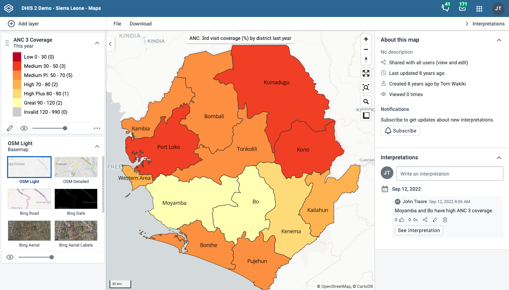

### Layers panel

The **layer panel** on the left side of the workspace shows an overview of the layers for the
current map:

-   As layers are added, using the **(+) Add layer** button, they are arranged and managed in this
    panel.

-   The **basemap** card is always shown at the bottom of the panel. See
    [Basemaps](#using_maps_basemaps) for available options.

-   The small arrow button to the right of the layer panel, at the top, allows the panel to be
    hidden or shown.

Each layer is represented by a card in the panel. Along the top of the card are a grab handle for
reordering layers with the mouse, the layer title, and an arrow to collapse or expand the card. The
middle of the card shows the layer legend where applicable. Along the bottom of the card from left
to right are:

-   An edit (pencil) button opens the layer configuration dialog.

-   An eye symbol toggles the visibility of the layer.

-   A slider modifies the layer transparency.

-   A more actions (three dots) button provides additional options, including showing or hiding the
    data table, downloading the layer data, duplicating the layer, and removing the layer.

### Map controls

-   The **+** and **-** buttons on the map allow you to zoom in and out of the map respectively. The
    mouse scroll wheel zoom is continuous, allowing you to fit the map perfectly to your content.

-   The **rotate map** button (triangle arrows) allows you to rotate and tilt the map to enhance the
    view of your data. Press and hold the button (or hold the Control key on your keyboard) while
    moving your mouse to change the map view. Click the button again to reset the view.

-   **Fullscreen** (four arrows) allows you to view the map in fullscreen. To exit fullscreen, click
    the button again or press the escape key on your keyboard.

-   **Zoom to content** (bounded magnifying glass symbol) automatically adjusts the zoom level and
    map center position to put the data on your map in focus.

-   **Search** (magnifying glass symbol) allows searching for and jumping to a location on the map.

-   The **ruler** button allows you to measure distances and areas on the map.

-   Right-click on the map to show the longitude and latitude of that location.

### File menu

-   The **File** button near the top left allows you to open and save maps. See
    [using the maps file menu](#using_maps_file_menu) for more detailed information.

-   The **Download** button next to the File button allows you to download the current map as a PNG
    image.

-   The **Interpretations** button at top right opens an interpretations panel on the right side of
    the workspace. See [viewing interpretations](#mapsInterpretation) for more information.
## Create a new map { #using_maps_create_map }

When you open the Maps app, you start with an empty map canvas and the default basemap selected. If
a map is already open, start a new one using **File** > **New**. You can change the basemap at any
time from the basemap card in the layer panel (see [Basemaps](#using_maps_basemaps)).

To add a layer, click the **(+) Add layer** button in the top left. The layer selection dialog
opens:

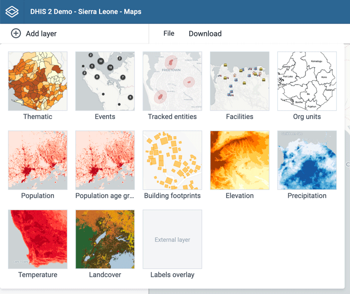

Available layer types are:

-   [**Thematic**](#using_maps_thematic_layer): Visualize data values (indicators or data elements)
    aggregated by organisation unit.
-   [**Events**](#using_maps_event_layer): Show individual events from event or tracker programs.
-   [**Tracked entities**](#using_maps_tracked_entity_layer): Show tracked entities and their
    relationships on the map.
-   [**Facilities**](#using_maps_facility_layer): Show facilities as icons based on their
    coordinates.
-   [**Org units**](#using_maps_org_unit_layer): Show organisation unit boundaries.

In addition, several layers can come from [Google Earth Engine](#using_maps_gee) (such as
population, elevation, or climate indicators) and
[other external services](#using_maps_external_map_layers). Various Google Earth Engine layer
sources are available if a Google Earth Engine service account key has been set up (see
[Google Earth Engine sign-up](#google_earth_engine_sign_up)).

> **Note**
>
> The [**Maps app administrator**](#maps_app_administrator) can:
>
> -   Choose the sources for Google Earth Engine layers available to other users using the **Manage
>     available layer sources** button.
> -   Add external layer sources in the Maintenance app. The **Metadata Management** app does not
>     manage external map layers.
## Basemaps { #using_maps_basemaps }

A basemap provides the background map on which your data layers are shown. You can choose and
configure the basemap from the **basemap** card at the bottom of the layer panel.

The following basemaps are available by default:

-   **OSM Light**: A minimal, light-colored map based on OpenStreetMap data. This is the default
    basemap, unless a system administrator sets a different **Default basemap** in the **System
    Settings** app.
-   **OSM Dark**: A dark-themed map based on OpenStreetMap data. Useful when the colors on your data
    layers are bright.
-   **OSM Fiord**: A muted, blue-toned map based on OpenStreetMap data.
-   **OSM Detailed**: Contains more map features and place names.
-   **Sentinel-2 EOX**: Cloud-free satellite imagery showing natural-color views of the Earth's
    surface at 10m resolution.

If a Bing Maps or Azure Maps API key has been configured by a system administrator, four additional
basemaps become available from each provider. Both providers offer the same four styles, prefixed
with the provider name, for example **Bing Road** and **Azure Road**:

-   **Road**: Shows roads, borders and places.
-   **Dark**: A dark-themed road map. Useful when the colors on your data layers are bright.
-   **Aerial**: Satellite and detailed aerial imagery.
-   **Aerial Labels**: Aerial imagery with place name labels.

A [**Maps app administrator**](#maps_app_administrator) can also add external basemaps in the
Maintenance app. These appear in the basemap card alongside the default basemaps.

Basemap layers are represented by a card in the layer panel. The card shows the list of available
basemaps with the current one highlighted. Controls at the bottom allow you to toggle the basemap
visibility and adjust its transparency.

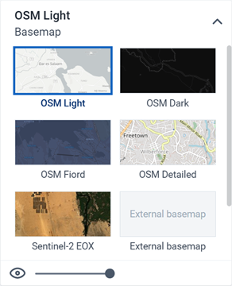

> **Note**
>
> Microsoft is retiring Bing Maps. Free (Basic) Bing Maps keys stopped working on 30 June 2025, and
> paid Bing Maps for Enterprise licences end on 30 June 2028. To set up Azure Maps instead, see
> [Azure Maps and Bing Maps basemaps setup](#azure_maps_and_bing_maps_basemaps_setup).
## Manage thematic layers { #using_maps_thematic_layer }

_Thematic maps_ represent spatial variation of geographic distributions. They show aggregated data
values for a selected data item (such as an indicator or data element), period and organisation unit
level. Organisation units with coordinates and matching data values will appear on the map.

> **Note**
>
> You must generate the DHIS2 analytics tables to have aggregated data values available.

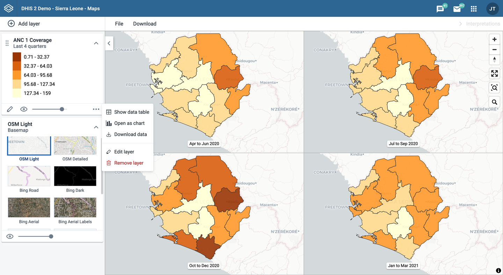

Thematic layers are represented by layer cards in the layer panel. The middle of the card shows a
legend indicating the value ranges shown on the layer. The more actions (three dots) button includes
options to show or hide the data table, download the data, and open the data as a chart in the Data
Visualizer app using **Open in Data Visualizer app**.

### Create a thematic layer

To create a thematic layer, choose **Thematic** on the **Add layer** selection. This opens the
Thematic layer configuration dialog.

#### 1. Data

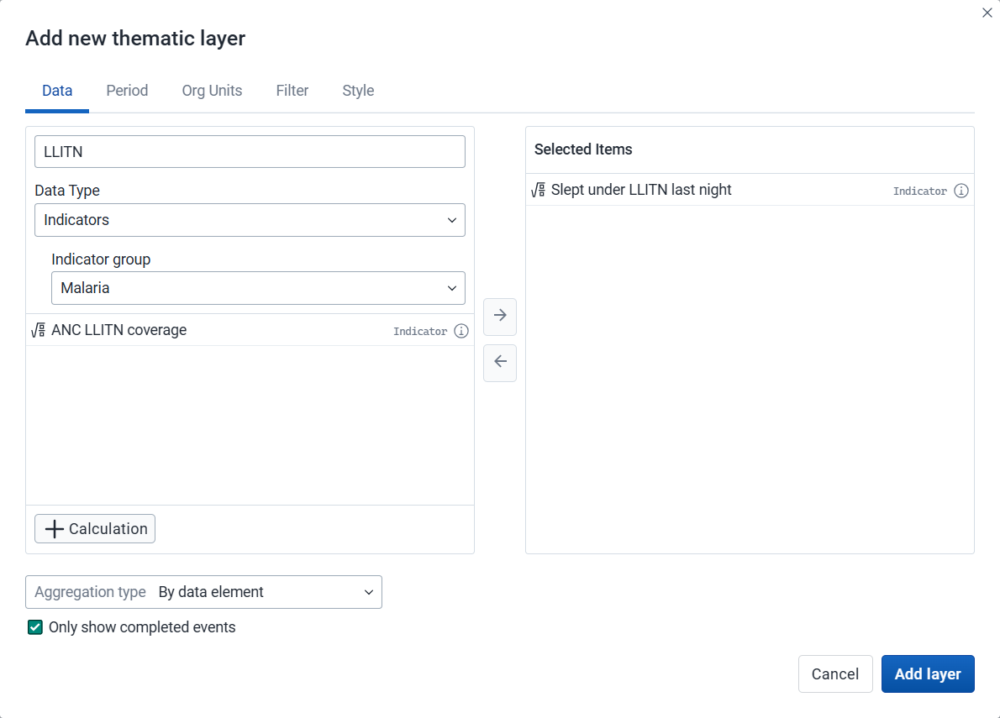

-   Choose a data item.

-   Choose a value from the **Aggregation type** field for the data values to be shown on the map.
    By default, "By data element" is selected. Alternative values are: Count, Average, Sum, Standard
    deviation, Variance, Min, Max. See also Aggregation operators in the
    [Metadata Management app](#mm_create_data_element) or the
    [Maintenance app](#create_data_element). The Metadata Management app replaces the Maintenance
    app and works with DHIS2 2.41 and later.

-   **Only show completed events**: Includes only completed events in the aggregation process. This
    is useful when you want to exclude partial events in indicator calculations. Available for
    indicators, program indicators and event data items.

#### 2. Period

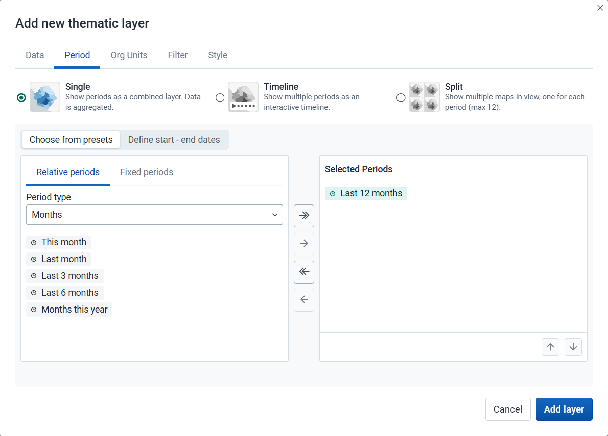

Choose the time span over which the thematic data is mapped.

-   Choose how to show the selected periods on the map:

    -   **Single** (default): Shows all selected periods as a single combined layer with aggregated
        data. Required when only one period is selected or when using start–end dates.

    -   **Timeline**: Shows multiple periods as an interactive timeline ordered chronologically.
        Multiple timeline layers can be added to a map (they will all share the same periods).

    -   **Split**: Shows multiple periods side by side for comparison. Supports up to 12 periods
        (including multi-period presets) and can only be combined with other split layers (they will
        all share the same periods).

-   After you choose a display mode, choose how to define the periods:

    -   **Choose from presets**: Available for all display modes. You can combine one or more
        relative and fixed periods.

        -   _Relative period_: Choose **Relative periods**, then the **Period type** (for example
            **Years** or **Months**) and choose one or more relative periods, such as **This year**
            and **Last year** or **Last 12 months**. A **default relative period for analysis** can
            be set in the **System Settings** app.

        -   _Fixed period_: Choose **Fixed periods**, then choose the **Period type** (for example
            **Yearly** or **Monthly**) and choose one or more fixed periods, such as **2024** or
            **January 2025** and **February 2025**.

    -   **Define start–end dates**: Available only when the Single display mode is selected. Specify
        exact start and end dates. Both dates are inclusive and will be reflected in the outputs.

#### 3. Org units

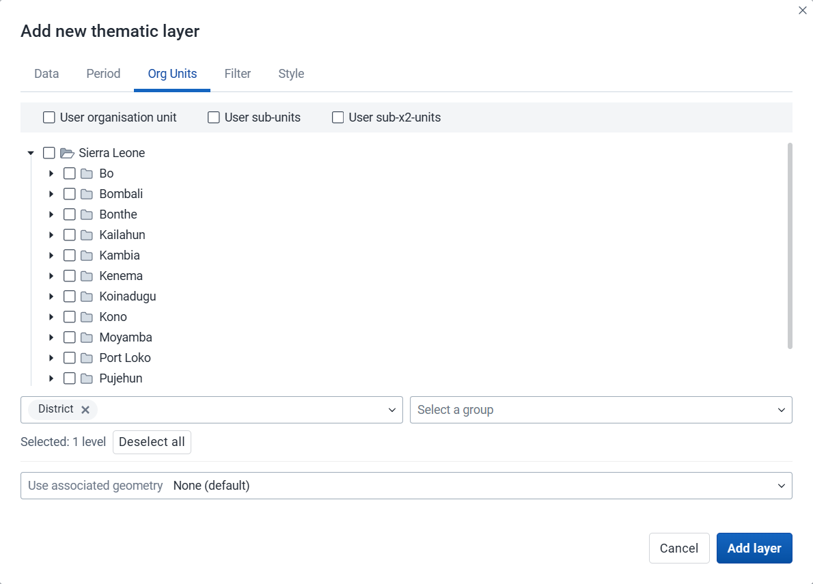

-   Choose the organisation units you want to include in the layer. You can freely combine specific
    org units, organisation unit levels, organisation unit groups, and relative user organisation
    units (**User organisation unit**, **User sub-units**, **User sub-x2-units**). When user
    organisation units are selected, the map data will appear according to the assigned organisation
    units for each user in the organisation unit hierarchy.

    > **Tip**: Levels and groups act as filters within the organisation units you choose - combining
    > them will show only organisation units at those levels or in those groups that are descendants
    > of your selected organisation units.

-   **Use associated geometry**: This field is shown only if there are additional geometries
    available for your organisation units. This is typically used to show facility catchment areas.

#### 4. Filter

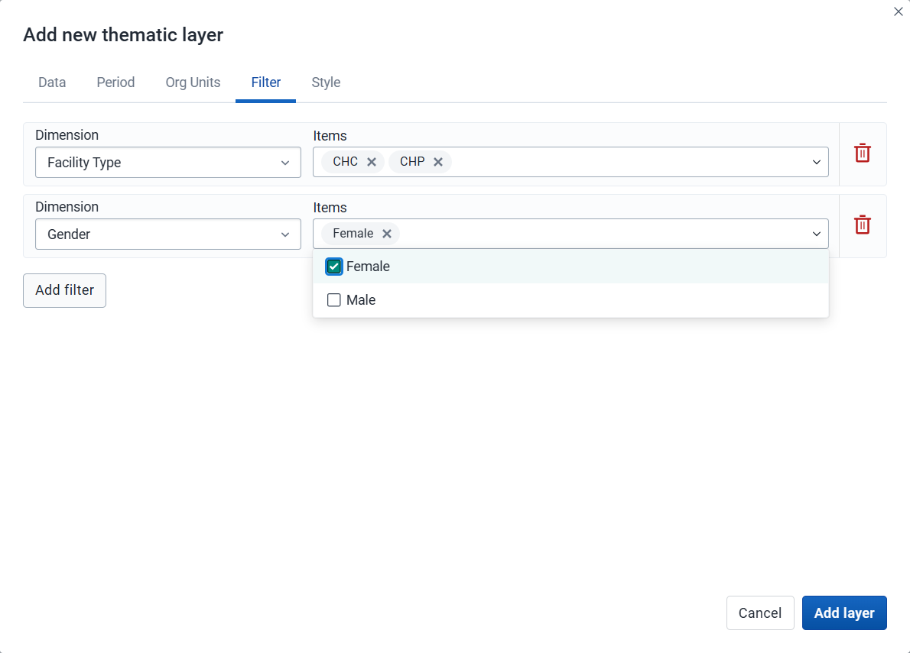

-   Click **Add filter** and choose an available data item to add a new filter to the data set.

    -   Choose a data dimension from the menu. You can reduce the number of dimensions shown by
        using the search field. Click the name to choose a dimension.

    -   When a dimension is selected you get a second menu with dimension items. Check the items you
        want to include in the filter.

    You can add multiple filters. Click the trash button on the right of the filter to remove it.

#### 5. Style { #using_maps_thematic_layer_style }

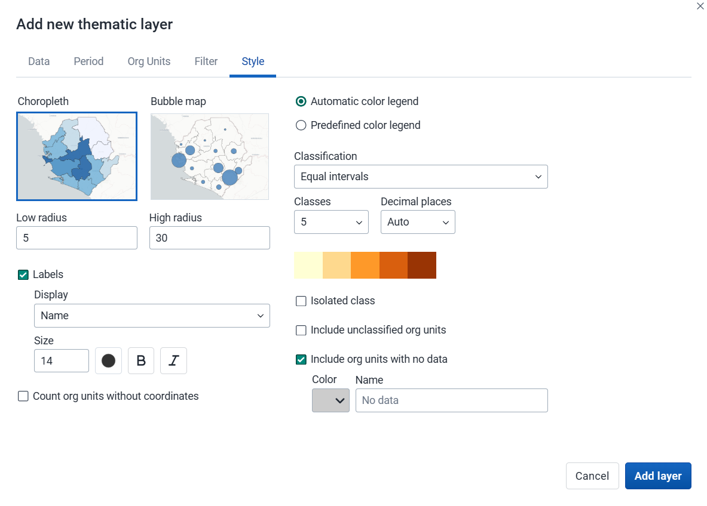

-   Choose either **Choropleth** or **Bubble map**.

    -   A choropleth map assigns a color to each organisation unit shape according to the data
        value. This is the recommended technique if the data is normalized (per capita).

    -   A bubble map shows data values as proportional circles. Use this technique if the data is
        not normalized (absolute numbers). The circles are placed in the center of each organisation
        unit. Set the **Low radius** and **High radius** for the proportional circles. The circles
        will be scaled between low and high radius according to the data value. The radius must be
        between 0 and 50 pixels.

-   **Labels**: Show organisation unit names and/or values on the layer. Choose **Name**, **Name and
    value**, or **Value**. Font size, weight, style and color can also be modified.

-   **Count org units without coordinates**: Organisation units without map coordinates are counted
    and shown in a **Data quality** section of the legend. They also appear in the data table. These
    organisation units might or might not have data.

-   Choose the legend type:

    -   **Automatic color legend**: A legend is automatically created based on the classification
        method, number of classes and color scale you choose. Set **Classification** to one of:

        -   **Equal intervals**: Divides the value range into equally-sized intervals, each spanning
            (highest value − lowest value) ÷ number of classes.
        -   **Equal counts**: Organisation units are distributed as evenly as possible across
            classes (also known as quantile classification). Some datasets cannot be evenly
            partitioned, particularly when values are heavily repeated or the number of distinct
            values is small.
        -   **Natural breaks (intervals)** and **Natural breaks (clusters)**: Class boundaries are
            placed at the largest gaps in the data distribution, based on the
            [ckmeans](https://simple-statistics.github.io/docs/#ckmeans) algorithm. Both methods
            group values similarly; **Natural breaks (intervals)** produces contiguous class ranges,
            while **Natural breaks (clusters)** can leave gaps between classes where no values fall.
        -   **Pretty breaks**: Break points are rounded to clean, human-readable numbers. Based on
            R's [pretty](https://www.rdocumentation.org/packages/base/versions/3.6.2/topics/pretty)
            algorithm.
        -   **Logarithmic scale**: Uses a logarithmic scale. Values must be positive; zero or
            negative values are left unclassified.
        -   **Standard deviation**: Classes are defined as multiples of standard deviations from the
            mean. The number of standard deviations per class depends on the number of classes
            chosen; values further from the mean are left unclassified.

        **Decimal places**: Number of decimal places shown in legend labels. **Auto** lets the app
        decide based on the data range, or choose a fixed value from **0** to **6** (also available
        for single color legends).

        **Isolated class**: Define a value range (min–max) with a fixed color and optional label.
        Organisation units in that range are shown separately and excluded from automatic
        classification.

    -   **Predefined color legend**: Choose from the predefined legends.

    -   **Single color legend**: Choose the color of the bubbles or circles. Only available for
        bubble maps.

-   **Include unclassified org units**: Organisation units whose values fall outside all
    classification ranges are shown with a configurable color and label (default: "Unclassified").

-   **Include org units with no data**: Organisation units with no data value are shown with a
    configurable color and label (default: "No data").

> **Note**: All legend items and their counts - including **No data** and **Unclassified** - only
> include organisation units with coordinates.

> **Note**
>
> Most classes use half-open intervals (`startValue ≤ value < endValue`): a value sitting exactly on
> a boundary belongs to the upper class, not the one whose label ends there. The exceptions - where
> the upper bound is inclusive - are the last class, isolated classes, single-value classes, and
> clusters (natural breaks).
>
> If the exact class a boundary value belongs to matters for your analysis, use **Labels** to
> overlay values directly on each feature. If it still matters after that, consider whether a
> different legend, maybe with more classes or higher decimal precision, is the right tool for the
> decision you are trying to make.

Click **Add layer**.

### Modify a thematic layer

1.  In the layer panel, click the edit (pencil) icon on the thematic layer card.

2.  Modify the settings on any of the tabs as desired.

3.  Click **Update layer**.

### Filter values in a thematic layer

Thematic layers have a **Show data table** option in the more actions (three dots) menu of the layer
card. When the table is open, the option changes to **Hide data table**.

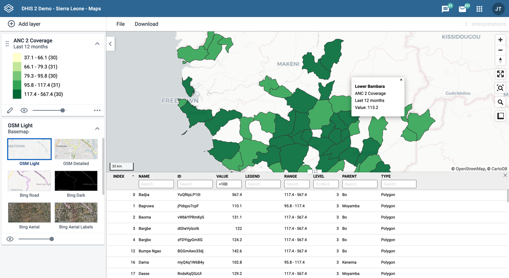

The data table shows the data associated with the thematic layer. Click the arrow buttons in a
column header to sort by that column. Type in the filter fields below each column header to filter
the rows shown.

The name filter field is an effective way to search for individual organisation units.

For numeric columns, you can filter using comparison operators: `>`, `<`, `>=`, and `<=`. Use `,`
for OR logic and `&` for AND logic. For example: `2,>3&<8` matches the value 2 or any value greater
than 3 and less than 8.

> **Note**
>
> Data table filters are temporary and are not saved with the map.

### Open organisation unit profile

You can open the [organisation unit profile](#using_maps_org_unit_profile) in three ways:

1. Click an organisation unit on the map, then click the **View profile** button in the popup.

2. Right-click one of the organisation units on the map, and choose **View profile** from the menu.

3. Click an organisation unit row in the **data table**.

### Navigate between organisation unit hierarchies

When there are visible organisation units on the map, you can navigate up and down in the hierarchy
without changing the organisation unit selection.

1.  Right-click one of the organisation units.

2.  Choose **Drill up one level** or **Drill down one level**.

    The drill down option is disabled if you are on the lowest level or if there are no coordinates
    available on the level below. Likewise, the drill up option is disabled from the highest level.

### Remove a thematic layer

To remove a thematic layer from the map, in the layer card to the left, click the _more actions_
(three dots) icon and then click **Remove layer**.
## Manage event layers { #using_maps_event_layer }

The event layer shows the geographical location of events recorded in DHIS2 programs. While in
thematic layers you can visualize event data aggregated to organisation unit level, with event
layers you can show the individual events or cases when they have their own point or polygon
coordinates. Alternative coordinate fields also let you plot events using locations other than the
event itself, such as the organisation unit or enrollment location.

To show aggregated event statistics at the organisation unit level, use a thematic layer with event
data items instead.

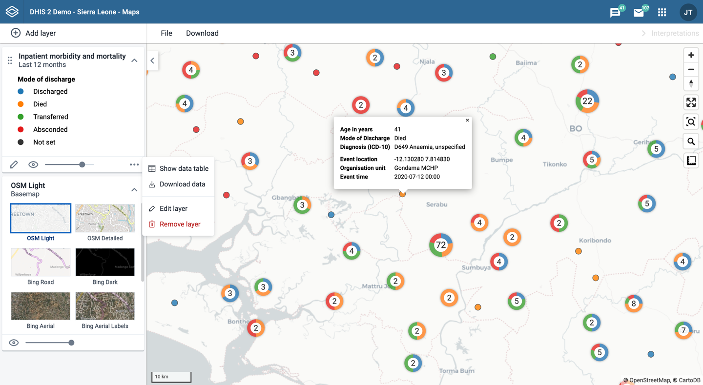

Event layers are represented by layer cards in the layer panel. The middle of the card shows a
legend indicating the styling of the layer. The more actions (three dots) button includes options to
show or hide the data table and to download the data in GeoJSON format.

### Create an event layer { #maps_create_event_layer }

To create an event layer, choose **Events** on the **Add layer** selection. This opens the Events
layer configuration dialog.

#### 1. Data

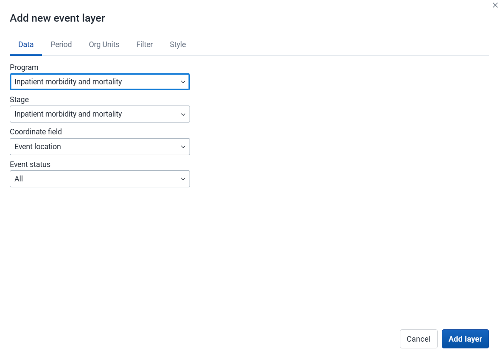

-   Choose a program and then choose a program stage. The **Stage** field is shown only after you
    choose a program.

    If there is only one stage available for the selected program, the stage is automatically
    selected.

-   Choose a value from the **Coordinate field** to determine which positions are shown on the map.
    By default, **Event location** is selected. You can also choose **Organisation unit location**.
    Depending on the selected program, additional options can include **Tracked entity location**,
    **Enrollment location**, and coordinate or organisation unit type data elements or attributes,
    such as "Household location" or "Referral facility". The number of events shown on the map can
    vary depending on the selected option and the availability of coordinates. When organisation
    unit location is used, polygons are represented by their centroids.

-   By default, all events with coordinates are shown on the map. Use the **Event status** field to
    only show events having one status: Active or Completed.

#### 2. Period

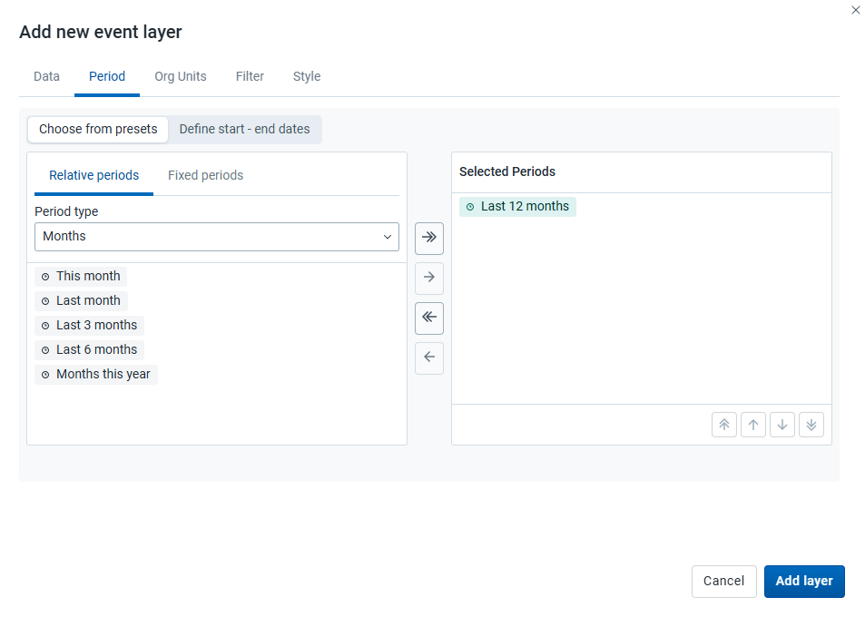

Choose the time span for when the events took place.

-   **Choose from presets**: You can combine one or more relative and fixed periods.

    -   _Relative period_: Choose **Relative periods**, then the **Period type** (for example
        **Years** or **Months**) and choose one or more relative periods, such as **This year** and
        **Last year** or **Last 12 months**. A **default relative period for analysis** can be set
        in the **System Settings** app.

    -   _Fixed period_: Choose **Fixed periods**, then choose the **Period type** (for example
        **Yearly** or **Monthly**) and choose one or more fixed periods, such as **2024** or
        **January 2025** and **February 2025**.

-   **Define start–end dates**: Specify exact start and end dates. Both dates are inclusive and will
    be reflected in the outputs.

#### 3. Org units

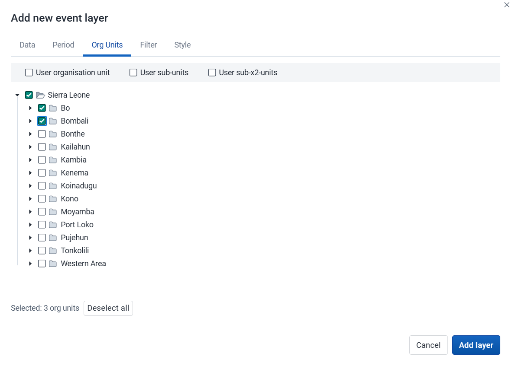

-   Choose the organisation units you want to include in the layer. You can combine specific
    organisation units and relative user organisation units (**User organisation unit**, **User
    sub-units**, **User sub-x2-units**). When user organisation units are selected, the map data
    will appear according to the assigned organisation units for each user in the organisation unit
    hierarchy. Data from all organisation units within and below the selected organisation units is
    included (**Selected and all below**).

#### 4. Filter

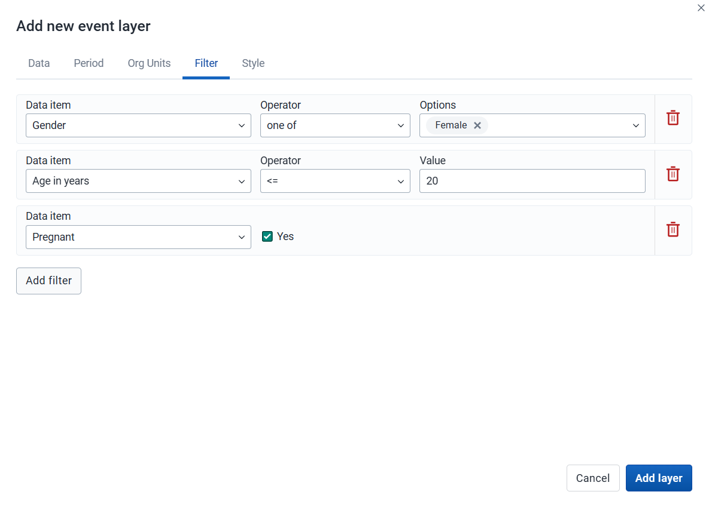

-   Click **Add filter** and choose an available data item to add a new filter to the data set.

    -   For data item of type _option set_, you can choose any of the options from the menu, or type
        to filter.

    -   For data item of type _number_, you can choose operators like equal, not equal, greater than
        or less than.

    -   For data item of type _boolean_ (yes/no), you can check the box if the condition should be
        true.

    -   For data item of type _text_, choose **Contains** (matches any value containing the search
        text) or **Is exact** (matches only identical values).

    You can add multiple filters. Click the trash button on the right of the filter to remove it.

#### 5. Style

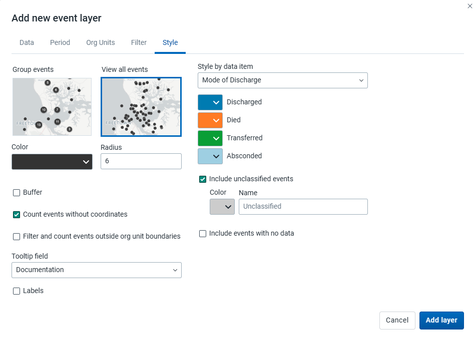

-   Choose **Group events** to group nearby events (cluster), or **View all events** to show events
    individually.

    -   Choose a **color** and **radius** for the event or cluster points.

    -   Choose **Buffer** to show a visual buffer around each event. The radius of the buffer can be
        modified here. Only available when **View all events** is selected.

-   **Count events without coordinates**: Events without coordinates are counted and shown in a
    **Data quality** section of the legend. They also appear in the data table. These events might
    or might not have data.

-   **Filter and count events outside org unit boundaries**: Events falling outside the boundaries
    of the selected organisation units are excluded from the map, and counted in the **Data
    quality** section of the legend, which also flags when some or all of the selected organisation
    units lack boundary data. These events remain in the data table, but can be identified by their
    empty **Organisation unit boundary** column value. Events inside a boundary are tagged with the
    name of their containing organisation unit in that same column.

-   **Label**: Choose a data element or attribute to show on the layer. Font size, weight, style and
    color can also be modified.

-   Choose **Style by data item** (data element or attribute) to colorize the events according to a
    data value. If events are grouped, clusters are shown as small donut charts showing the
    distribution of the data values. The available options vary for different data types:

    -   **Option sets**: Choose a color for each option in an option set. You can set default colors
        for an option in the Metadata Management app.

    -   **Numbers**: You can style a numeric data item in
        [the same way as thematic layers](#using_maps_thematic_layer_style) using automatic or
        predefined legends.

    -   **Booleans**: Choose a color for true/yes and another for false/no.

    **Include unclassified events**: Events whose values fall outside all classification ranges are
    shown with a configurable color and label (default: "Unclassified").

    **Include events with no data**: Events with no data value are shown with a configurable color
    and label (default: "No data").

> **Note**: All legend items and their counts - including **No data** and **Unclassified** - only
> include events with coordinates.

Click **Add layer**.

### Modify an event layer

1.  In the layer panel, click the edit (pencil) icon on the event layer card.

2.  Modify the settings on the **Data**, **Period**, **Filter**, **Org units** and **Style** tabs as
    desired.

3.  Click **Update layer**.

### Filter events

Event layers have a **Show data table** option in the more actions (three dots) menu of the layer
card. When the table is open, the option changes to **Hide data table**.

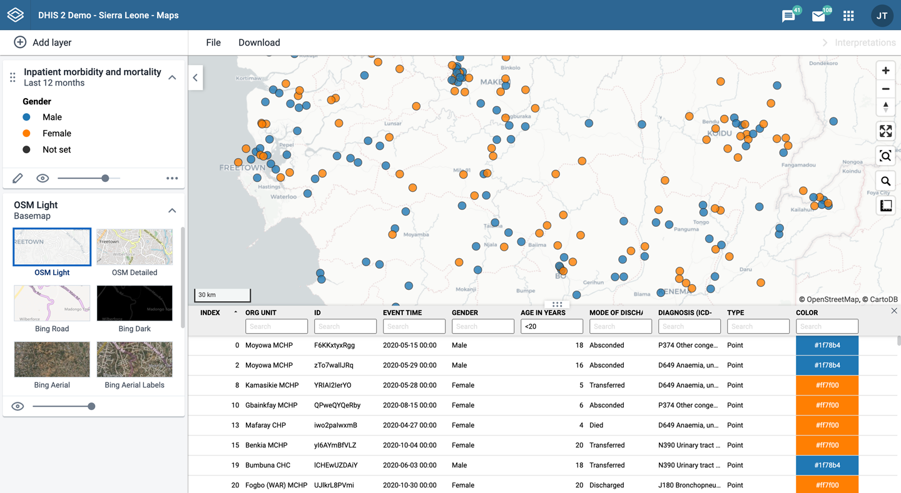

The data table shows the data associated with the event layer. Click the arrow buttons in a column
header to sort by that column. Type in the filter fields below each column header to filter the rows
shown.

Additional columns appear for data elements that have **Display in reports** selected, and for any
data item used to style the events. You can filter both the data value and the color in those
columns. Numeric columns support comparison operators: `>`, `<`, `>=`, and `<=`, with `,` for OR and
`&` for AND logic. For example: `2,>3&<8`.

> **Note**
>
> Data table filters are temporary and are not saved with the map.

### Modify information in event data table and popups

If you have access to the selected program in the Metadata Management app, you can modify the
information shown in the event popup window.

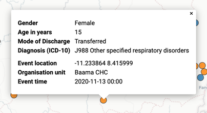

1.  Open the **Metadata Management** app.

2.  Choose **Programs**.

3.  Click the program you want to modify and choose **Data** or the stage first then **Data** in the
    case of a Tracker program.

4.  For every data element you want to show in the popup window, choose the corresponding **Display
    in reports**.

5.  Click **Save**.

### Download raw event layer data

The raw data for event layers can be downloaded in GeoJSON format for more advanced geo-analytics
and processing in desktop GIS software such as [QGIS](https://www.qgis.org/). The downloaded data
includes all individual events as GeoJSON features, including attributes for each data element
selected for **Display in reports**.

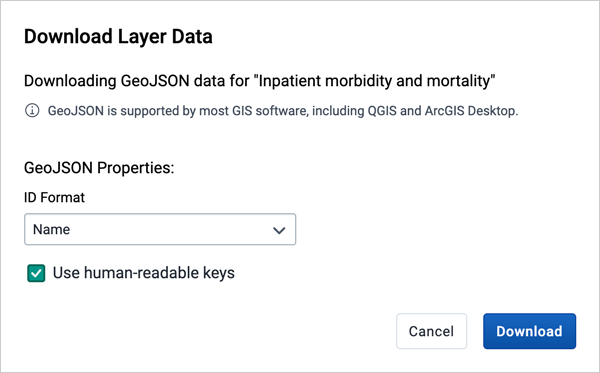

-   In the layer card to the left, click the _more actions_ (three dots) icon and then click
    **Download data**.

-   Choose the **ID Format** to use as the key for data element values in the downloaded GeoJSON
    file:

    -   **ID**: Use the unique ID of the data element.
    -   **Name**: Use the human-friendly name of the data element (translated).
    -   **Code**: Use the code of the data element.

-   Choose whether or not to **Use human-readable keys** for other event attributes, such as Program
    Stage, Latitude, Longitude, Event Data, and Org Unit ID, Name, and Code. When this option is
    **not** selected, these values will be computer-friendly IDs instead of human-readable
    (translated) names.

-   Click the **Download** button to generate and download a GeoJSON file. The data will be
    requested from the DHIS2 server and processed by the maps application. This operation can take
    several minutes to complete.

-   After you download the GeoJSON file, you can import it into most standard GIS software.

> **Note**
>
> The downloaded data does not include style information as it is not natively supported by the
> GeoJSON format. Styles can optionally be recreated in external GIS applications using the
> attributes of each feature.

### Remove an event layer

To remove an event layer from the map, in the layer card to the left, click the _more actions_
(three dots) icon and then click **Remove layer**.
## Manage tracked entity layers { #using_maps_tracked_entity_layer }

The tracked entity layer shows the geographical location of tracked entities registered in DHIS2.
Tracked entities with associated point or polygon coordinates appear on the map.

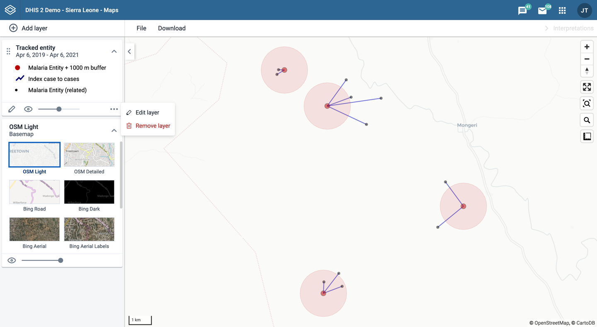

Tracked entity layers are represented by layer cards in the layer panel. The middle of the card
shows a legend indicating the styling of the layer.

### Create a tracked entity layer { #maps_create_tracked_entity_layer }

To create a tracked entity layer, choose **Tracked entities** on the **Add layer** selection. This
opens the Tracked entity layer configuration dialog.

#### 1. Data

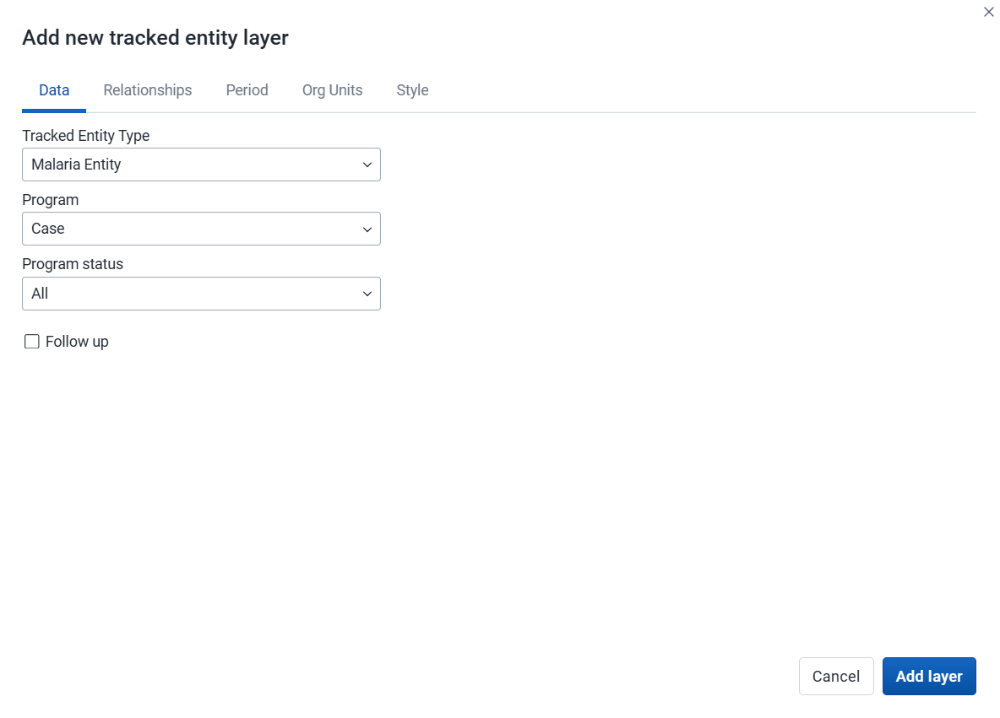

-   Choose the **Tracked entity type** you want to show on the map.

-   Choose a **Program** to filter tracked entities by enrollment.

-   Use the **Program status** field to choose the enrollment status of tracked entities to include:
    All, Active, Completed, or Cancelled.

-   Filter by the **Follow up** flag to include only tracked entities marked for follow-up.

#### 2. Relationships

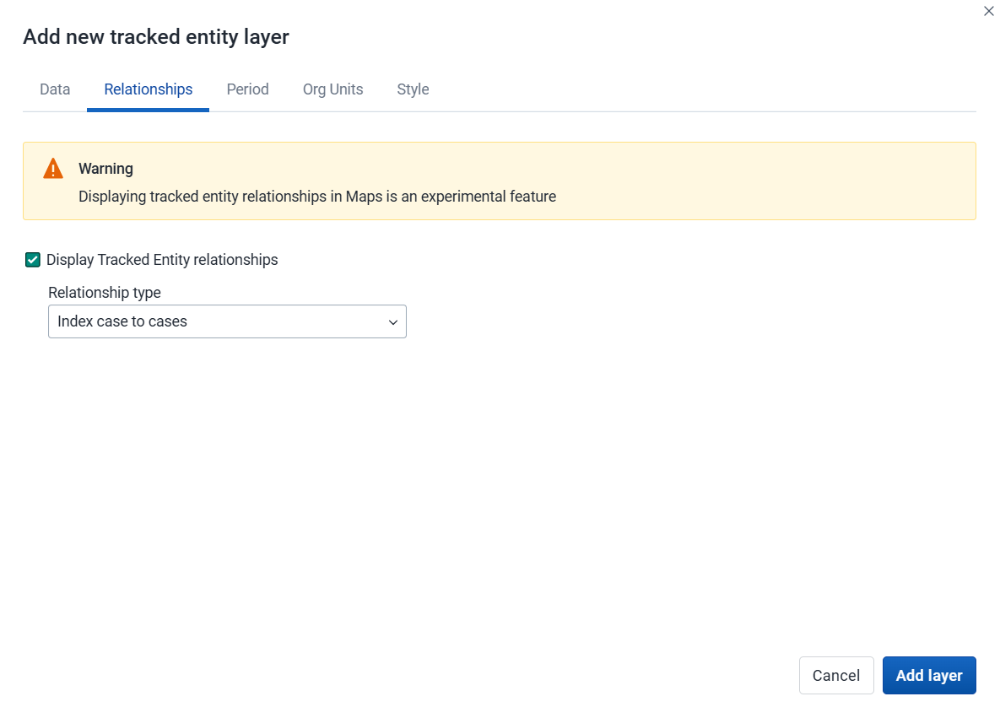

> **Caution**
>
> Displaying tracked entity relationships in Maps is an experimental feature.

-   Choose the **Display Tracked Entity relationships** checkbox to show relationships on the map.

-   Choose the **Relationship type** to show from the list. Only relationships from the selected
    tracked entity type to tracked entities are available. Relationships to events or enrollments
    are not shown.

-   Relationships are drawn from the tracked entities shown by the layer. The related tracked
    entities at the other end are filtered as follows:
    -   **Org units:** the same organisation units and selection mode as the layer.
    -   **Period:** the same dates as the layer. If the layer uses the enrollment date, the dates
        apply to the enrollment date of the related tracked entities when the relationship type sets
        a program for them, and to their last updated date otherwise.
    -   **Program, program status and follow-up:** not applied. The related tracked entities are
        shown whatever program they are in, unless the relationship type sets one.

#### 3. Period

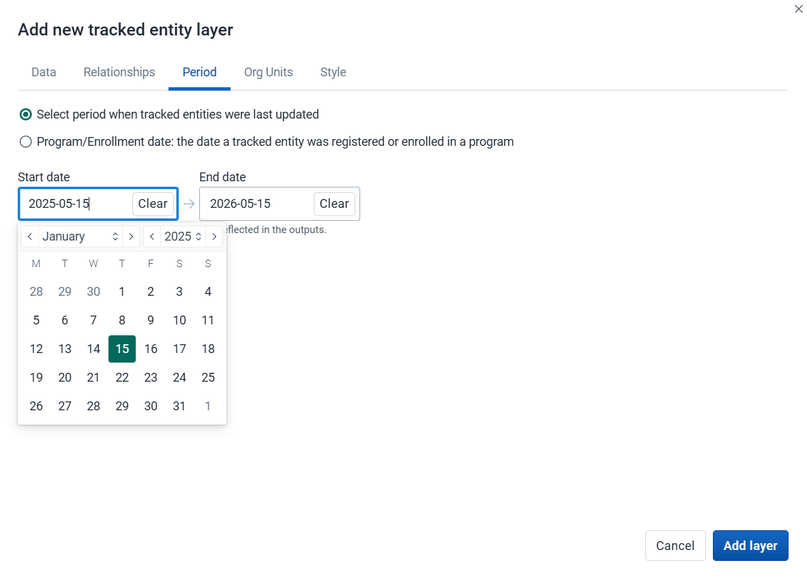

-   If no program is selected, you can set start and end dates for when the tracked entities were
    last updated.

-   If a program is selected, you can set the period when tracked entities were last updated or when
    they were enrolled in the program.

#### 4. Org units

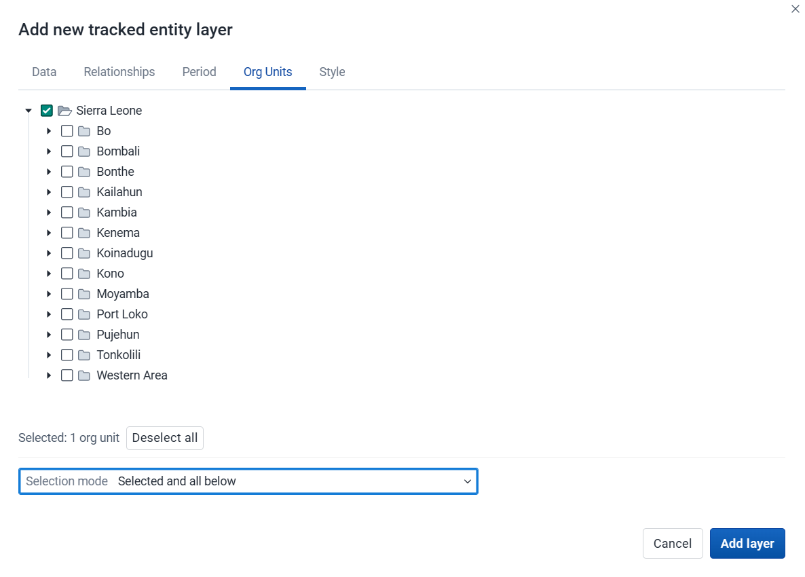

-   Choose the organisation units you want to include in the layer. Only specific organisation units
    can be selected. A **selection mode** determines how the organisation unit tree is traversed:

    -   **Selected only**: Include tracked entities belonging to selected organisation units only.

    -   **Immediate children**: Include tracked entities in the organisation units right below
        selected org units, not in the selected organisation units themselves.

    -   **Selected and all below**: Include tracked entities in and all below selected organisation
        units.

    In v40, the default selection mode of a tracked entity layer in the Maps app is **Selected
    only**.

    From v41, the default selection mode of a tracked entity layer in the Maps app is **Selected and
    all below**.

#### 5. Style

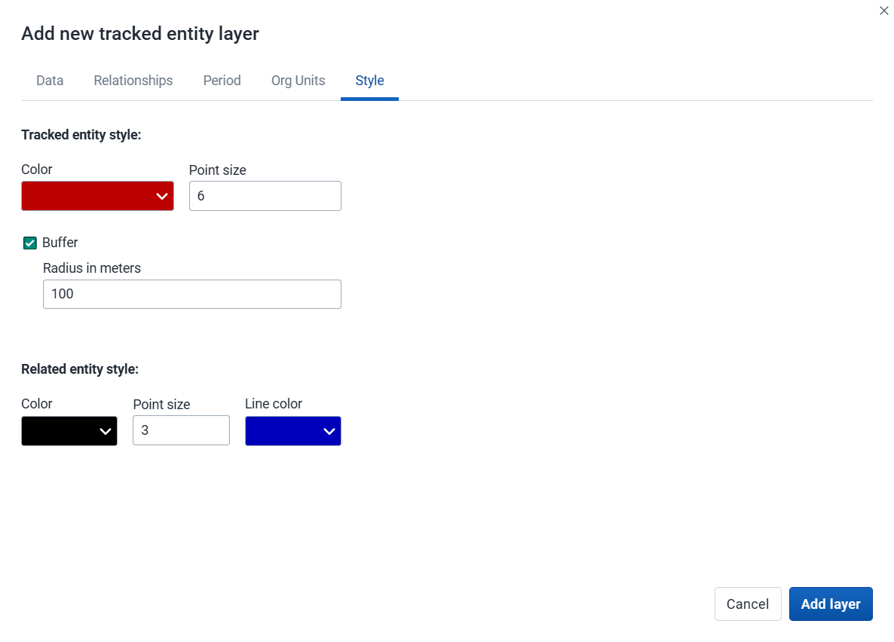

-   Choose a **Color** for tracked entity points and polygons.

-   Choose the **Point size** for the points.

-   Choose **Buffer** to show a visual buffer around each tracked entity. The buffer distance in
    meters can be modified here.

-   If a relationship type has been selected on the Relationships tab, you can choose a **Color**
    and **Point size** for related tracked entities and a **Line color** for the relationship lines.

Click **Add layer**.

### Modify a tracked entity layer

1.  In the layer panel, click the edit (pencil) icon on the tracked entity layer card.

2.  Modify the settings on the **Data**, **Relationships**, **Period**, **Org units** and **Style**
    tabs as desired.

3.  Click **Update layer**.

### Modify information in tracked entity popups

If you have access to the selected program in the Metadata Management app, you can modify the
information shown in the tracked entity popup window.

1.  Open the **Metadata Management** app.

2.  Choose **Programs**.

3.  Click the program you want to modify and choose **Enrollment: Data**.

4.  For every attribute you want to show in the popup window, enable **Display in list**.

5.  Click **Save**.

### Remove a tracked entity layer

To remove a tracked entity layer from the map, in the layer card to the left, click the _more
actions_ (three dots) icon and then click **Remove layer**.
## Manage facility layers { #using_maps_facility_layer }

The facility layer shows icons representing types of facilities. Only point-type organisation units
are shown - polygon organisation units such as districts or regions are not shown.

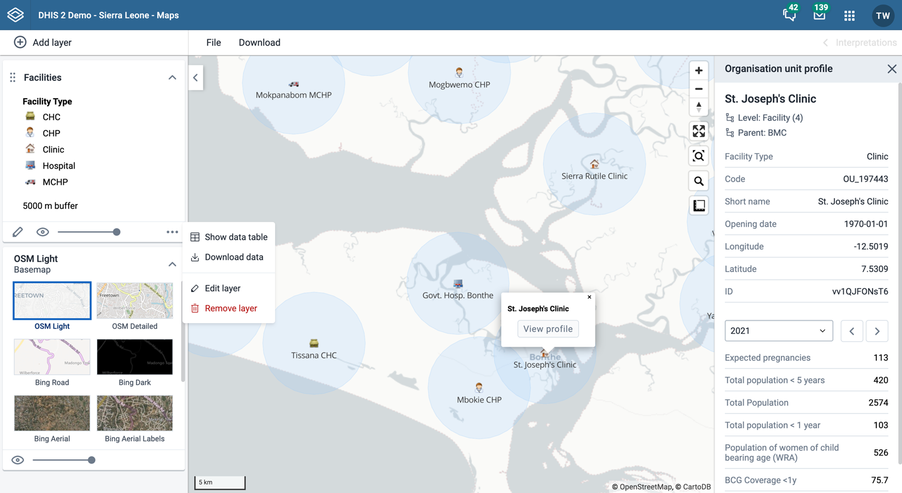

Facility layers are represented by layer cards in the layer panel. The middle of the card shows a
legend indicating the group set representation. The more actions (three dots) button includes
options to show or hide the data table and to download the data in GeoJSON format.

### Create a facility layer

To create a facility layer, choose **Facilities** on the **Add layer** selection. This opens the
Facility layer configuration dialog.

#### 1. Org units

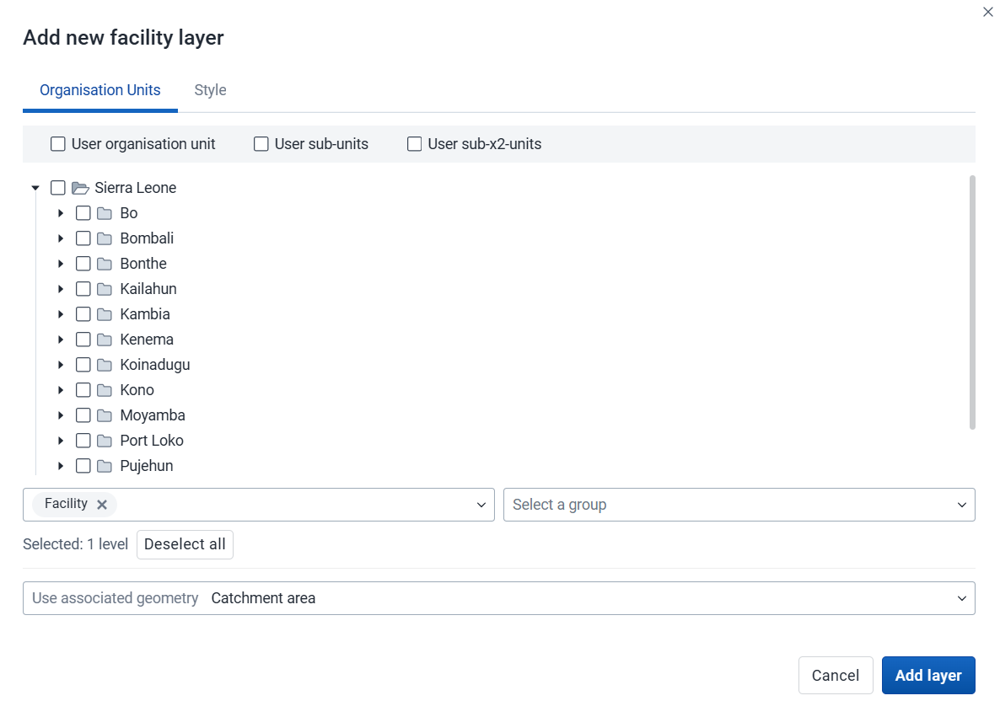

-   Choose the organisation units you want to include in the layer. You can freely combine specific
    org units, organisation unit levels, organisation unit groups, and relative user organisation
    units (**User organisation unit**, **User sub-units**, **User sub-x2-units**). When user
    organisation units are selected, the map data will appear according to the assigned organisation
    units for each user in the organisation unit hierarchy. Only organisation units with a point
    location are shown.

    > **Tip**: Levels and groups act as filters within the organisation units you choose - combining
    > them will show only organisation units at those levels or in those groups that are descendants
    > of your selected organisation units.

-   The system administrator can set the default organisation unit level containing facilities in
    the **System Settings** app.

-   **Use associated geometry**: This field is shown only if there are additional geometries
    available for your organisation units. This is typically used to show facility catchment areas.

#### 2. Style

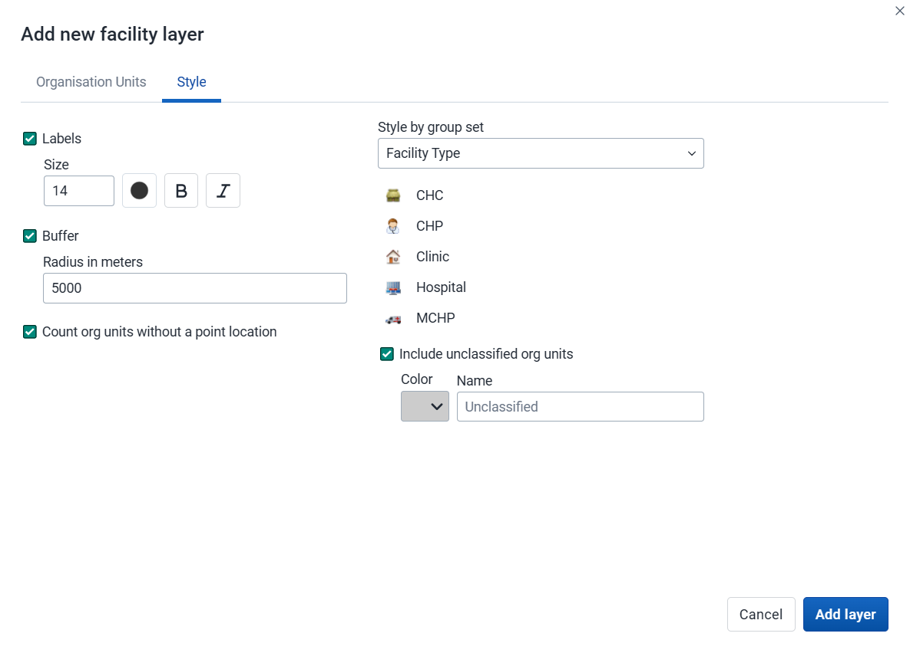

-   **Labels**: Allows labels to be shown on the layer. Font size, weight and color can be modified
    here.

-   **Buffer**: Shows a visual buffer around each facility. The radius of the buffer can be modified
    here. Not available if associated geometry is used.

-   **Count org units without a point location**: Organisation units without point coordinates are
    counted and shown in a **Data quality** section of the legend. They also appear in the data
    table.

-   Facilities with a point location can be styled with an organisation unit group set using
    different icons. Choose a group set from the list of organisation unit group sets defined for
    your DHIS2 instance. The system administrator can set the default organisation unit group set in
    the **System Settings** app.

    **Include unclassified org units**: Organisation units not belonging to any group in the
    selected group set are shown with a configurable color and label (default: "Unclassified").

-   If no group set is selected, the facilities will be shown as filled circles. The color and
    radius can be changed.

Click **Add layer**.

### Modify a facility layer

1.  In the layer panel, click the edit (pencil) icon on the facility layer card.

2.  Modify the settings on the **Org units** and **Style** tabs as desired.

3.  Click **Update layer**.

### Filter values in a facility layer

Facility layers have a **Show data table** option in the more actions (three dots) menu of the layer
card. When the table is open, the option changes to **Hide data table**.

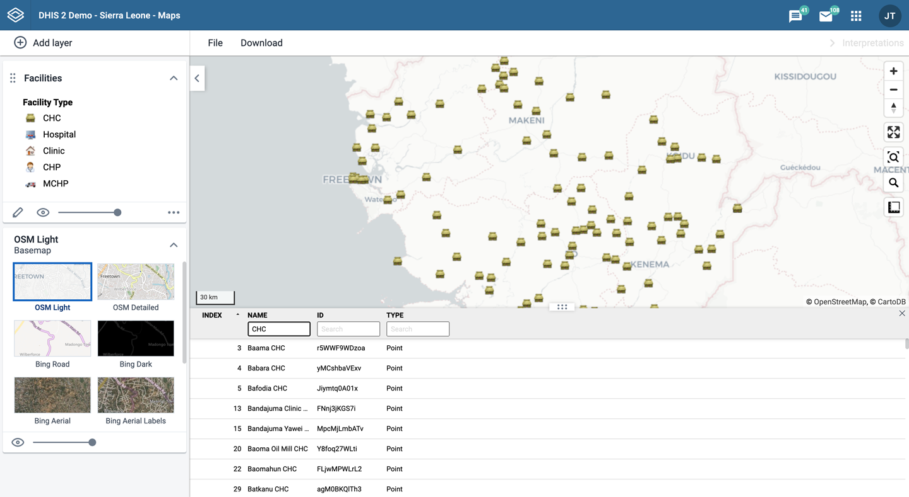

The data table shows the data associated with the facility layer. Click the arrow buttons in a
column header to sort by that column. Type in the filter fields below each column header to filter
the rows shown. The name filter field is an effective way to search for individual facilities.

> **Note**
>
> Data table filters are temporary and are not saved with the map.

### Open organisation unit profile

You can open the [organisation unit profile](#using_maps_org_unit_profile) in three ways:

1. Click an organisation unit on the map, then click the **View profile** button in the popup.

2. Right-click one of the organisation units on the map, and choose **View profile** from the menu.

3. Click an organisation unit row in the **data table**.

### Remove a facility layer

To remove a facility layer from the map, in the layer card to the left, click the _more actions_
(three dots) icon and then click **Remove layer**.
## Manage organisation unit layers { #using_maps_org_unit_layer }

The organisation unit layer shows the borders and locations of your organisation units. This layer
is particularly useful if you are offline and do not have access to background maps.

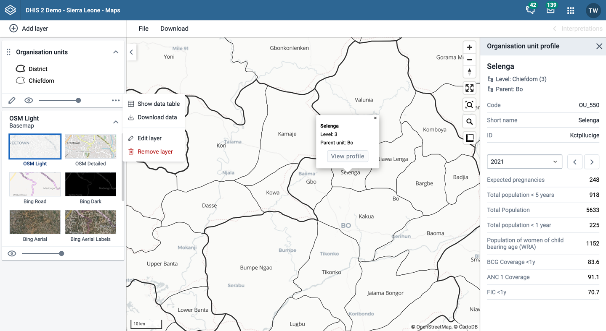

Organisation unit layers are represented by layer cards in the layer panel. The more actions (three
dots) button includes options to show or hide the data table and to download the data in GeoJSON
format.

### Create an organisation unit layer

To create an organisation unit layer, choose **Org units** on the **Add layer** selection. This
opens the Org unit layer configuration dialog.

#### 1. Org units

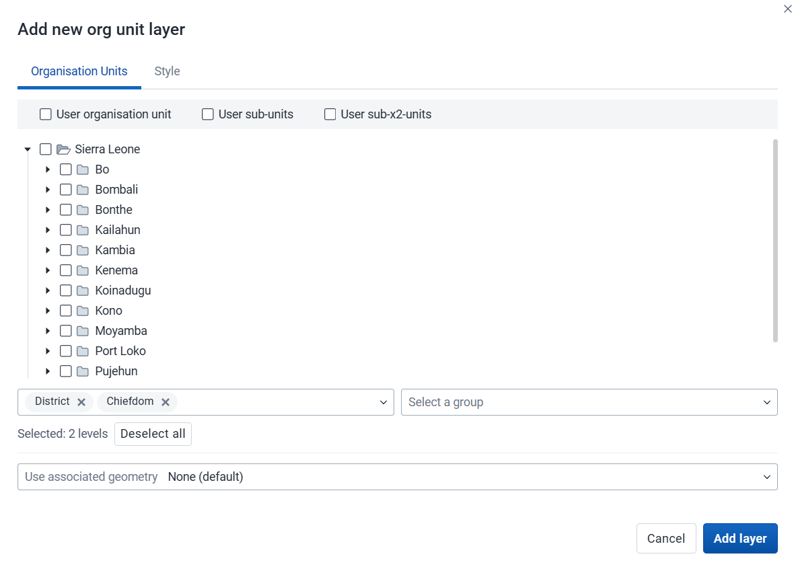

-   Choose the organisation units you want to include in the layer. You can freely combine specific
    org units, organisation unit levels, organisation unit groups, and relative user organisation
    units (**User organisation unit**, **User sub-units**, **User sub-x2-units**). When user
    organisation units are selected, the map data will appear according to the assigned organisation
    units for each user in the organisation unit hierarchy.

    > **Tip**: Levels and groups act as filters within the organisation units you choose - combining
    > them will show only organisation units at those levels or in those groups that are descendants
    > of your selected organisation units.

-   **Use associated geometry**: This field is shown only if there are additional geometries
    available for your organisation units. This is typically used to show facility catchment areas.

#### 2. Style

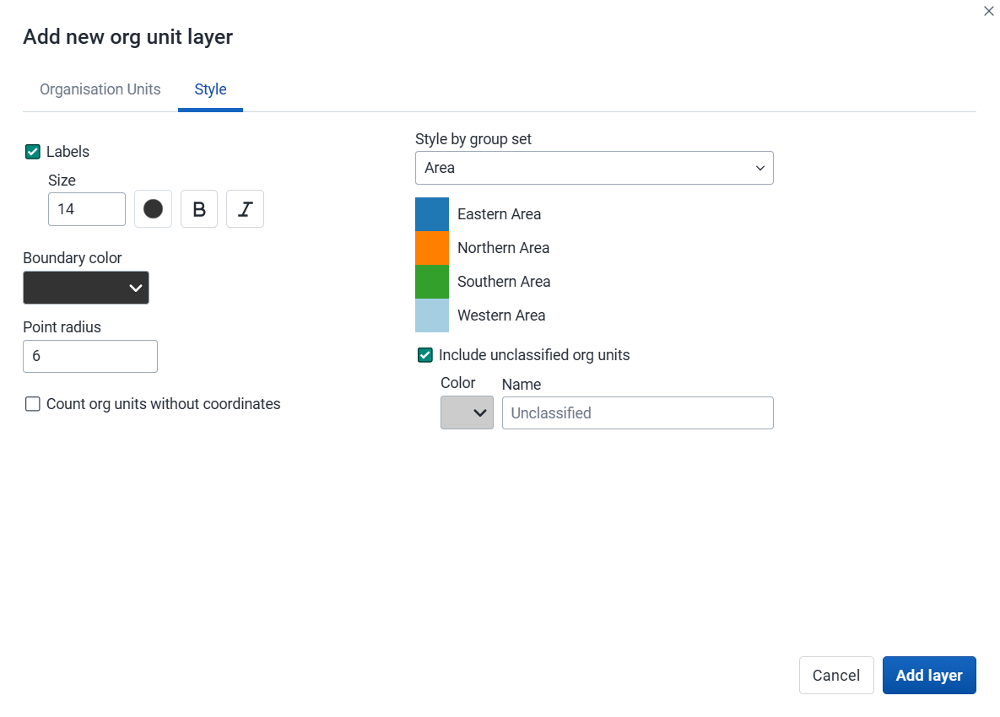

-   **Labels**: Allows labels to be shown on the layer. Font style can be modified here.

-   **Boundary color**: Allows the boundary or outline color of the organisation units to be
    changed.

-   **Point radius**: Sets the base radius when point type elements, such as facilities, are
    presented on the organisation unit layer.

-   **Count org units without coordinates**: Organisation units without coordinates are counted and
    shown in a **Data quality** section of the legend. They also appear in the data table.

-   Organisation units with coordinates can be styled with an organisation unit group set using
    different colors. Choose a group set from the list of organisation unit group sets defined for
    your DHIS2 instance.

    **Include unclassified org units**: Organisation units not belonging to any group in the
    selected group set are shown with a configurable color and label (default: "Unclassified").

Click **Add layer**.

### Modify an organisation unit layer

1.  In the layer panel, click the edit (pencil) icon on the organisation unit layer card.

2.  Modify the settings on the **Org units** and **Style** tabs as desired.

3.  Click **Update layer**.

### Filter values in an organisation unit layer

Organisation unit layers have a **Show data table** option in the more actions (three dots) menu of
the layer card. When the table is open, the option changes to **Hide data table**.

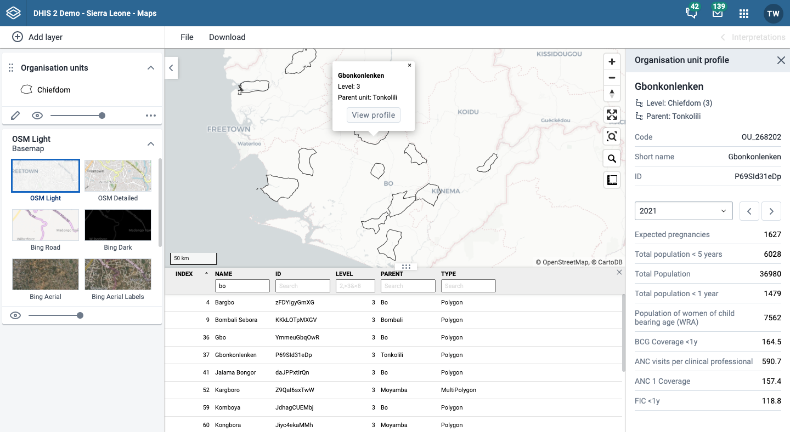

The data table shows the data associated with the organisation unit layer. Click the arrow buttons
in a column header to sort by that column. Type in the filter fields below each column header to
filter the rows shown. The name filter field is an effective way to search for individual
organisation units.

The level column supports numeric filtering using comparison operators: `>`, `<`, `>=`, and `<=`,
with `,` for OR and `&` for AND logic. For example: `2,>3&<8`.

> **Note**
>
> Data table filters are temporary and are not saved with the map.

### Open organisation unit profile

You can open the [organisation unit profile](#using_maps_org_unit_profile) in three ways:

1. Click an organisation unit on the map, then click the **View profile** button in the popup.

2. Right-click one of the organisation units on the map, and choose **View profile** from the menu.

3. Click an organisation unit row in the **data table**.

### Navigate between organisation unit hierarchies

When there are visible organisation units on the map, you can navigate up and down in the hierarchy
without changing the organisation unit selection.

1.  Right-click one of the organisation units.

2.  Choose **Drill up one level** or **Drill down one level**.

    The drill down option is disabled if you are on the lowest level. Likewise, the drill up option
    is disabled from the highest level.

### Remove an organisation unit layer

To remove an organisation unit layer from the map, in the layer card to the left, click the _more
actions_ (three dots) icon and then click **Remove layer**.
## Manage Earth Engine layers { #using_maps_gee }

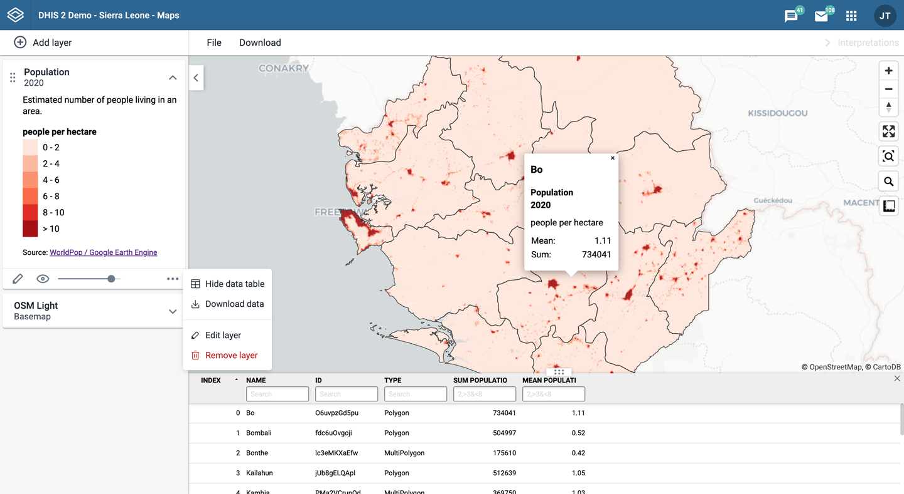

Google Earth Engine layers are enabled if a Google Earth Engine service account key has been
configured for your system. Contact your system administrator if you need access to these layers.
System administrators can set up the key by following
[Google Earth Engine sign-up](#google_earth_engine_sign_up).

The layers from Google Earth Engine let you show and aggregate external data for your organisation
units. Aggregated values can be viewed either in popups or in the data table.

Earth Engine layers are represented by layer cards in the layer panel. The more actions (three dots)
button includes options to show or hide the data table and to download the data.

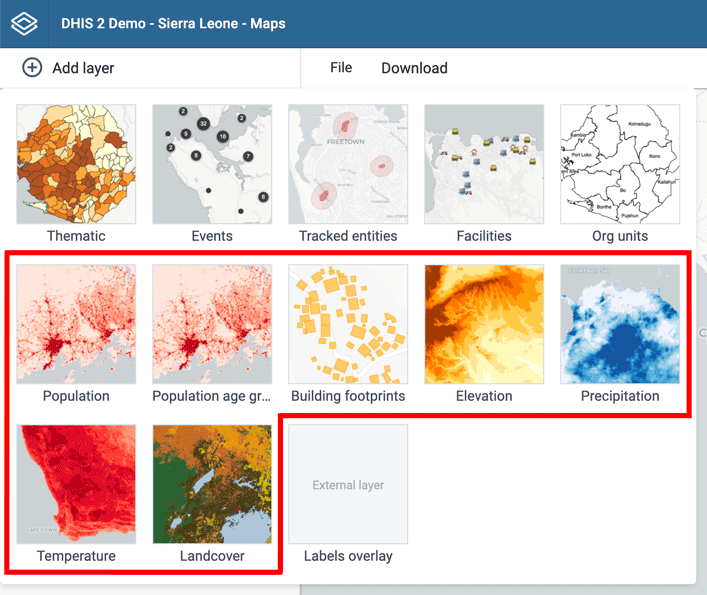

> **Note**
>
> The [**Maps app administrator**](#maps_app_administrator) can configure available layer sources.

The following layer sources are supported (sources marked with an asterisk "\*" are available by
default):

-   **Population** (group): Detailed population data from WorldPop. Estimates are provided annually
    and include current, historical, and projected population values. Available between 2015
    and 2030.

    -   **Population** \*: Total population count.
    -   **Population age groups** \*: Population broken down by age and gender.

-   **Building footprints** \*: The outlines of buildings derived from high-resolution satellite
    imagery. Only for sub-Saharan Africa, South and Southeast Asia, Latin America and the Caribbean.

-   **Elevation** \*: Elevation above sea level.

-   **Heat stress** (group): Universal Thermal Climate Index (UTCI), a measure of the thermal stress
    experienced by a person in a given environment. Available from 1950.

    -   **Heat stress daily**.
    -   **Heat stress weekly** (derived from daily dataset).
    -   **Heat stress monthly** (derived from daily dataset).

-   **Relative humidity** (group): Relative humidity is the amount of water vapour present in air.
    Available from 1950.

    -   **Relative humidity daily**.
    -   **Relative humidity weekly** (derived from daily dataset).
    -   **Relative humidity monthly**.

-   **Precipitation** (group): Accumulated water that falls to the surface. Combines model data with
    observations from across the world. Two sources are available:

    -   ERA5-Land. Available from 1950.
        -   **Precipitation daily**.
        -   **Precipitation weekly** (derived from daily dataset).
        -   **Precipitation monthly** \*.
    -   CHIRPS. Available from 1981.
        -   **Precipitation daily**.
        -   **Precipitation weekly** (derived from daily dataset).
        -   **Precipitation monthly** (derived from daily dataset).

-   **Temperature** (group): Temperature at 2m above the surface. Combines model data with
    observations from across the world. Available from 1950.

    -   **Temperature daily**.
    -   **Temperature weekly** (derived from daily dataset).
    -   **Temperature monthly** \*.

-   **Landcover** \*: 17 distinct landcover types collected from satellites by NASA. Available
    yearly since 2001.

-   **Vegetation**: Normalized difference vegetation index (NDVI) and Enhanced Vegetation Index
    (EVI), used to quantify vegetation greenness. Collected from satellites by NASA. Available at
    16-day intervals, from 2000.
    -   **Vegetation 16-day**
    -   **Vegetation weekly** (derived from 16-day dataset).
    -   **Vegetation monthly** (derived from 16-day dataset).

### Create an Earth Engine layer

To create an Earth Engine layer, choose the desired layer from the **Add layer** selection. This
opens the layer configuration dialog.

#### 1. Data

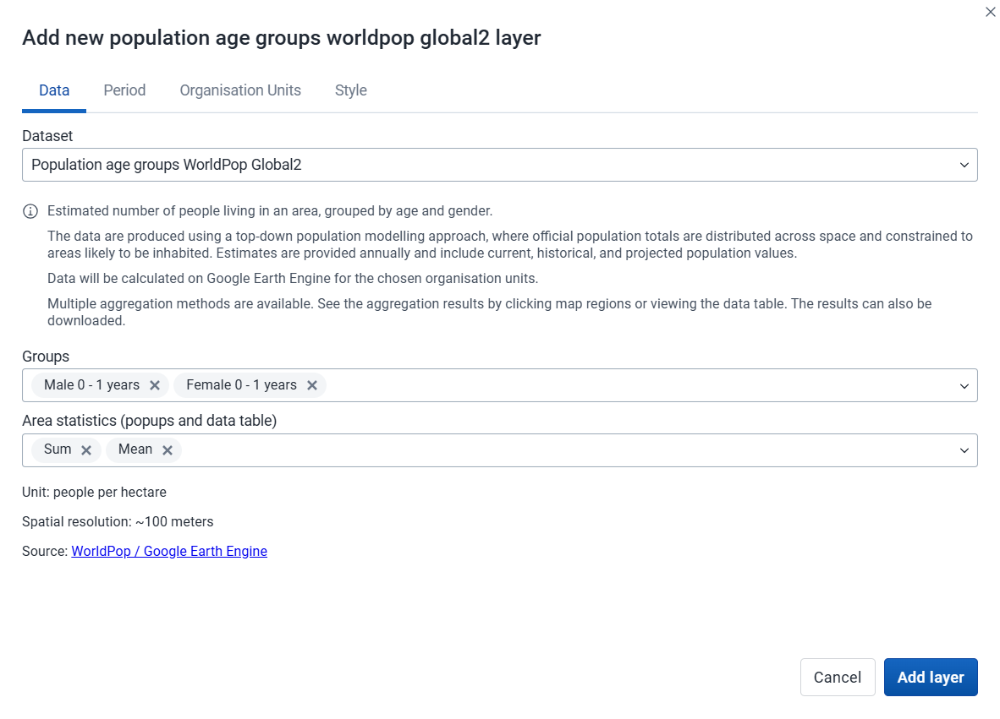

-   **Dataset** (if within a data group):

    -   For **Population** you can choose either the **Population** or the **Population age group**
        dataset.

-   **Data subset**:

    -   For **Population age groups** you can choose the age/gender **groups** you would like to
        include when aggregating the data.
    -   For **Temperature** or **Heat stress** you can choose the **temporal aggregation method**
        you want to use (Mean, Min, Max).
    -   For **Vegetation** you can choose the **index** you want to use (NDVI or EVI).

-   Choose the **spatial aggregation methods** to use when calculating values for the selected org
    units. This only affects results in popups and the data table (some options might not be
    available depending on the layer source).

    -   **Sum**: Calculates the total number within each organisation unit. Recommended to use for
        the population layers.

    -   **Min**: Returns the minimum value in the layer unit shown below the selection. For
        population layers it will be the minimum _people per hectare_. For the elevation layer it
        will return the lowest elevation (meters above sea level).

    -   **Max**: Returns the maximum value in the layer unit. For population layers it will be the
        maximum _people per hectare_. For the elevation layer it will return the highest elevation
        for each organisation unit.

    -   **Mean**: Returns the mean value in the layer unit. For population layers it will be the
        mean _people per hectare_. For the precipitation layer it will be the mean rainfall in
        millimeters across the organisation unit.

    -   **Median**: Returns the median value in the layer unit. For population layers it will be the
        median _people per hectare_. For the temperature layer it will be the median °C across the
        organisation unit.

    -   **Standard deviation**: Returns the standard deviation value in the layer unit.

    -   **Variance**: Returns the variance value in the layer unit.

    -   **Special cases**:
        -   For "building footprints": **Count**: Returns the number of buildings within each org
            unit. Note that building counts are only available for smaller organisation unit areas.
        -   For "landcover": **Percentage**, **Hectares**, **Acres**: Return the area covered by
            each landcover category within each organisation unit in different units.

#### 2. Period

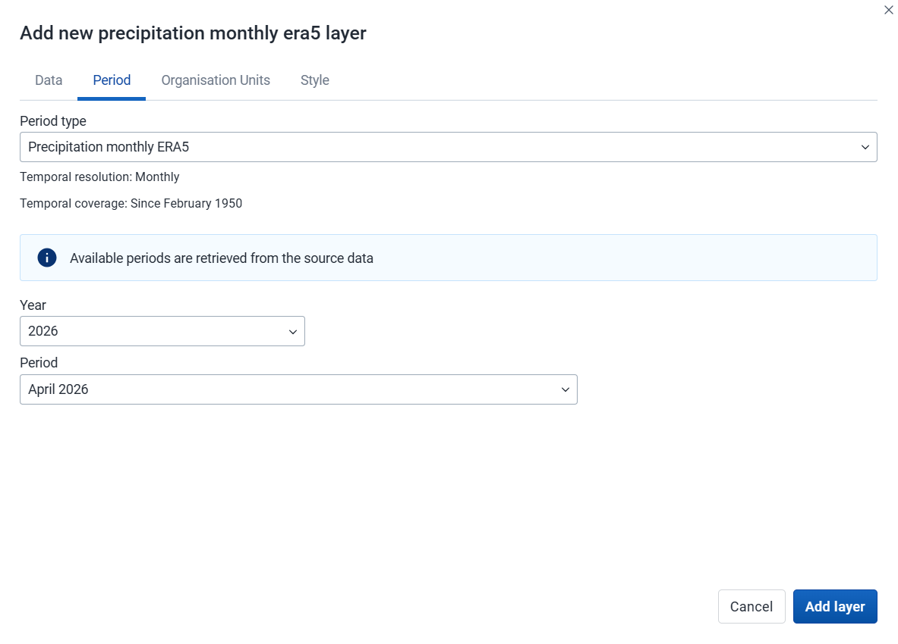

-   Choose the period type (if multiple sources are enabled for **Heat stress**, **Precipitation**,
    **Temperature**, or **Vegetation**).

-   Choose the period for the data source. The available periods are set by the layer source. Some
    sources are only available at a single point in time.

#### 3. Org units

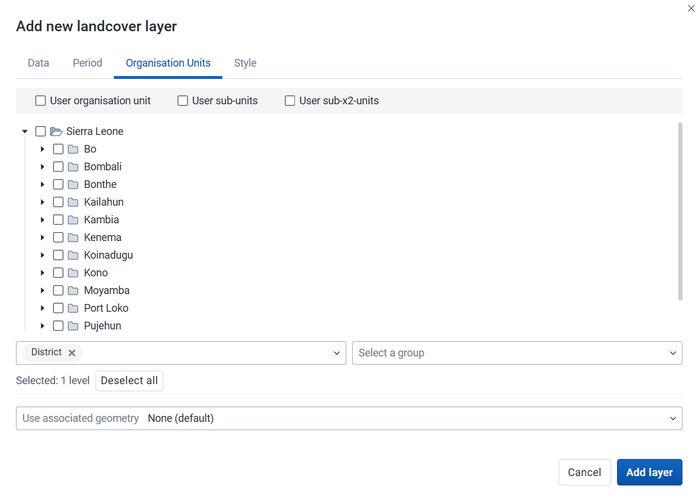

-   Choose the organisation units where you want to see aggregated data values. You can freely
    combine specific organisation units, organisation unit levels, organisation unit groups, and
    relative user organisation units (**User organisation unit**, **User sub-units**, **User
    sub-x2-units**). When user organisation units are selected, the map data will appear according
    to the assigned organisation units for each user in the org unit hierarchy.

    > **Tip**: Levels and groups act as filters within the organisation units you choose - combining
    > them will show only organisation units at those levels or in those groups that are descendants
    > of your selected organisation units.

-   **Use associated geometry**: This field is shown only if there are additional geometries
    available for your organisation units. This is typically used to calculate values for facility
    catchment areas.

#### 4. Style

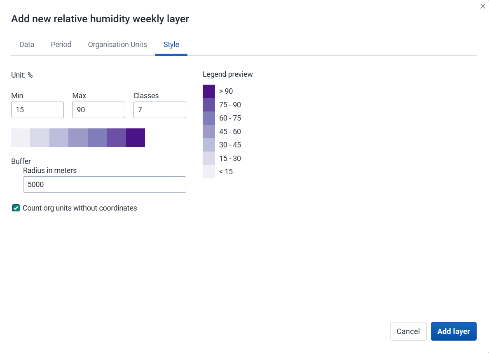

-   Adjust the legend **Min**, **Max**, number of **Classes**, and color map, as desired.

-   **Buffer**: If you choose organisation units with a single point coordinate (facilities), you
    can set a radius buffer to calculate the data value within. A radius of 5000 meters will
    aggregate all values available within a 5 km distance from a facility. Buffer option is not
    available if associated geometry is used.

-   **Count org units without coordinates**: Organisation units without coordinates are counted and
    shown in a **Data quality** section of the legend. They also appear in the data table.

Click **Add layer**.

Click an organisation unit or facility on the map to see the aggregation result.

### Modify an Earth Engine layer

1.  In the layer panel, click the edit (pencil) icon on the Earth Engine layer card.

2.  Modify the settings on the **Data**, **Period**, **Org units**, and **Style** tabs as desired.

3.  Click **Update layer**.

### Filter values in an Earth Engine layer

Earth Engine layers have a **Show data table** option in the more actions (three dots) menu of the
layer card. When the table is open, the option changes to **Hide data table**.

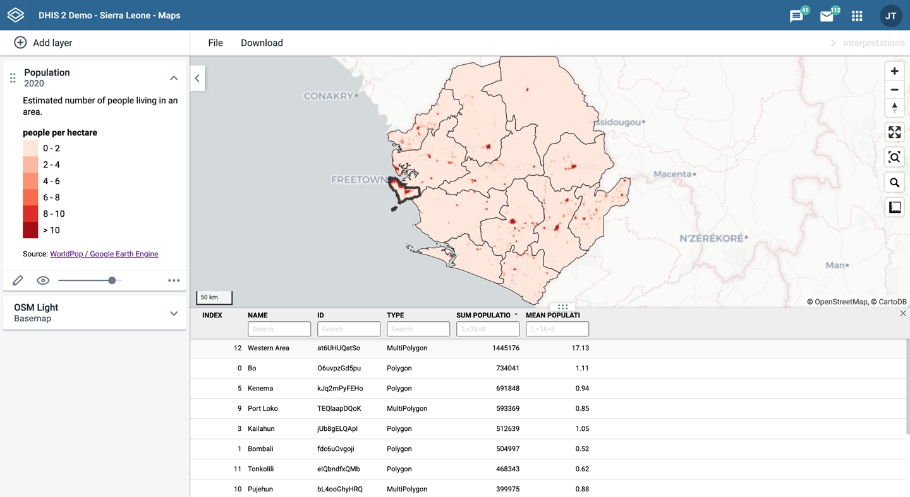

The data table shows all the aggregated values for the selected organisation units. Click the arrow
buttons in a column header to sort by that column. Type in the filter fields below each column
header to filter the rows shown.

There is one column for each selected aggregation type. These numeric columns support comparison
operators: `>`, `<`, `>=`, and `<=`, with `,` for OR and `&` for AND logic. For example: `2,>3&<8`.

> **Note**
>
> Data table filters are temporary and are not saved with the map.

### Open organisation unit profile

You can open the [organisation unit profile](#using_maps_org_unit_profile) in three ways:

1. Click an organisation unit on the map, then click the **View profile** button in the popup.

2. Right-click one of the organisation units on the map, and choose **View profile** from the menu.

3. Click an organisation unit row in the **data table**.

### Remove an Earth Engine layer

To remove an Earth Engine layer from the map, in the layer card to the left, click the _more
actions_ (three dots) icon and then click **Remove layer**.
## Add external map layers { #using_maps_external_map_layers }

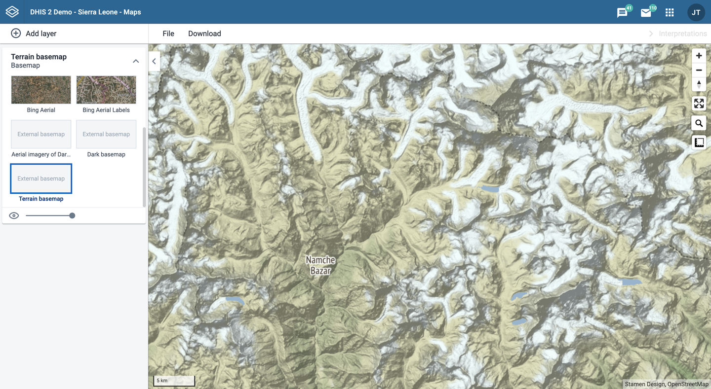

External map layers are represented as either basemaps or overlays.

> **Note**
>
> The [**Maps app administrator**](#maps_app_administrator) can add external map layers.

-   **Basemaps**

    These are available in the **basemap** card in the layers panel and are selected as any other
    basemap.

-   **Overlays**

    These are available in the **Add layer** selection. Unlike basemaps, overlays can be placed
    above or below any other overlay layers.

Overlay layers are represented by additional layer _cards_ in the layer panel.

Along the top of the overlay card from left to right are:

-   A grab field to allow dragging and re-ordering layers with the mouse

-   The title of the external map layer

-   An arrow symbol to collapse or expand the overlay card

In the middle of the card is a legend if the layer has one.

Along the bottom of the overlay card from left to right are:

-   An eye symbol to toggle the visibility of the layer

-   A slider for modifying the layer transparency

-   A more actions (three dots) button with options to duplicate the layer and to remove it from the
    current map

### GeoJSON external layers

If you add a GeoJSON external layer to your map, you will have a few style choices:

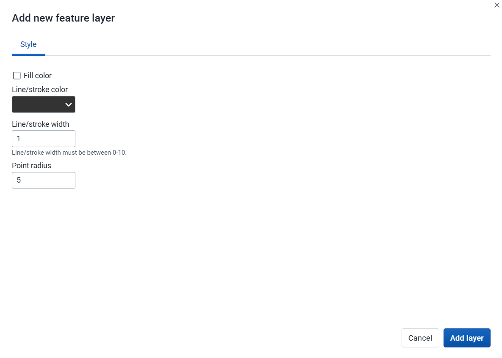

After the GeoJSON layer appears, you can open its data table with **Show data table** in the more
actions (three dots) menu. The menu also has an option to download the data.

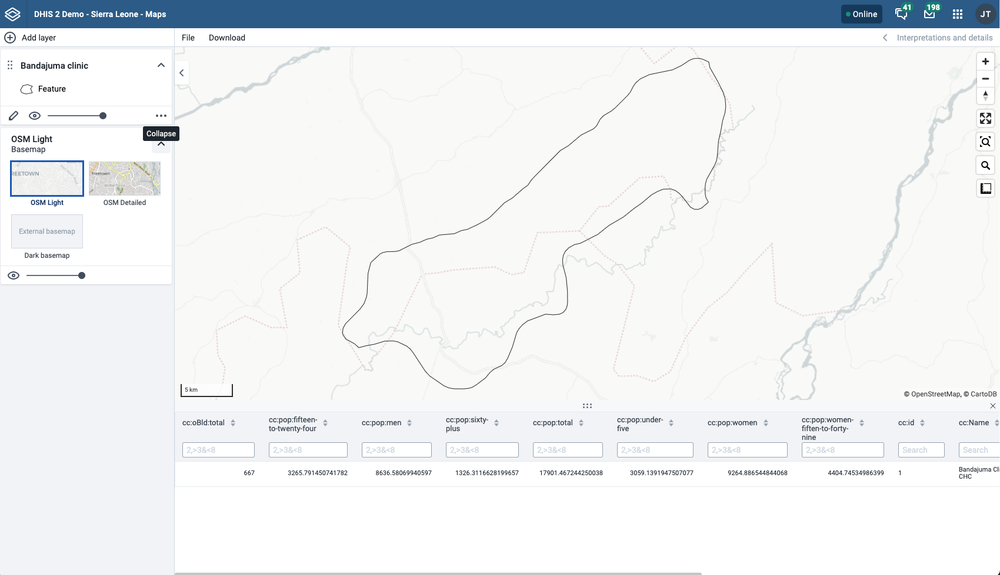

As with other layers, you can sort and filter the data. If you want to view the data for one row,
click the row to open the **Feature Profile**:

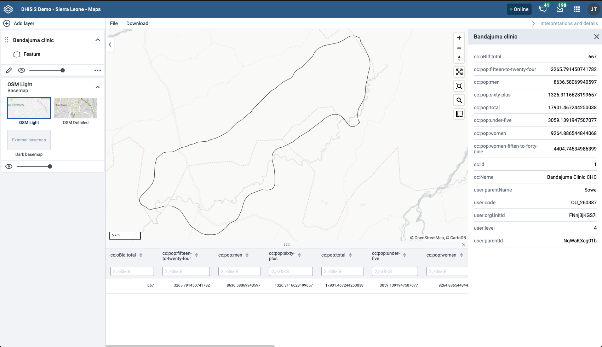
## Organisation unit profile { #using_maps_org_unit_profile }

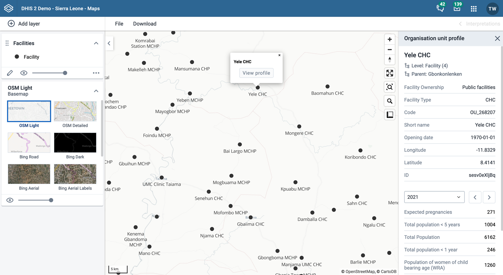

The organisation unit profile shows detailed information about each organisation unit. You can open
the profile from organisation unit layers, facility layers, thematic layers, and Earth Engine
layers.

You can open the organisation unit profile in three ways:

1. Click an organisation unit on the map, then click the **View profile** button in the popup.

2. Right-click one of the organisation units on the map, and choose **View profile** from the menu.

3. Click an organisation unit row in the **data table**.

The profile will show on the right side of the map. The profile content is set by the system
administrator.
## File menu { #using_maps_file_menu }

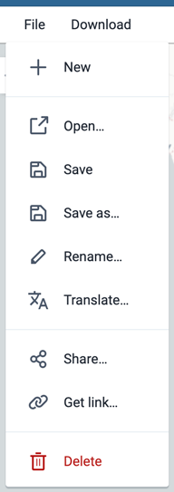

Use the **File menu** to manage your maps. Several menu items will be disabled until you open or
save a map.

Saving your maps makes it easy to restore them later. It also gives you the opportunity to share
them with other users as an interpretation or add them to a dashboard. You can save all types of
layer configurations as a saved map.

### Create a new map

Click **File** \> **New**.

> **Note**
>
> This will discard the current map without saving.

### Open a map

1.  Click **File** \> **Open**. A dialog box opens with a list of maps.

2.  Find the saved map you want to open. You can either use \< and \> or the search field to find a
    saved map. The list is filtered on every character that you enter. You can filter the list by
    choosing **Show all**, **Created by me** or **Created by others**.

3.  Click the name of the map you want to open.

### Save a map

When you have created a map it is convenient to save it for later use:

1.  Click **File** \> **Save**.

2.  Enter a **Name** (required) and a **Description** (optional) the first time you save a map.

3.  Click **Save**.

### Save a copy of a map

1.  Click **File** \> **Save as...**

2.  Enter a **Name** (required) and a **Description** (optional) for the map.

3.  Click **Save**.

### Rename a map

1.  Click **File** \> **Rename**.

2.  Enter a new **Name** and/or **Description** for your map.

3.  Click **Rename**. The map is updated.

### Translate a map

1.  Click **File** \> **Translate**.

2.  Choose the **Locale** (language) for your translation.

3.  Enter a translated **Name** and **Description**. The original text will show below the field.

4.  Click **Save**.

### Modify sharing settings for a map

After you have created a map and saved it, you can share the map with everyone or a user group. To
modify the sharing settings:

1.  Click **File** \> **Share**. The sharing settings dialog opens.

2.  **Give access to a user or group**: In the field, search for the name of the user or group you
    want to share your saved map with and choose it.

    Choose the access level and click **Give access**.

    Repeat the step to add more users or groups.

3.  **Users and groups that currently have access**: For each user or group, choose the access
    level. The options are:

    -   **No access**: The public will not have access to the map. This setting is only applicable
        to All users.

    -   **View only**: Users can view but not edit the map.

    -   **View and edit**: Users can view and edit the map.

    -   **Remove access**: Remove the access for groups or individuals.

4.  Click **Close** to close the dialog.

### Get the link to a map

1.  Click **File** \> **Get link**. A link dialog opens.

2.  Copy the link.

### Delete a map

1.  Click **File** \> **Delete**. A confirmation dialog is shown.

2.  Click **Delete** to confirm that you want to delete the saved map. Your map is deleted and the
    layers are cleared from the view.
## Map interpretations and details { #mapsInterpretation }

An interpretation is a description of a map for a given period. This information is also visible in
the **Dashboard** app. Click **Interpretations and details** in the top right of the workspace to
open the interpretations panel. The button is only available when the map has been saved.

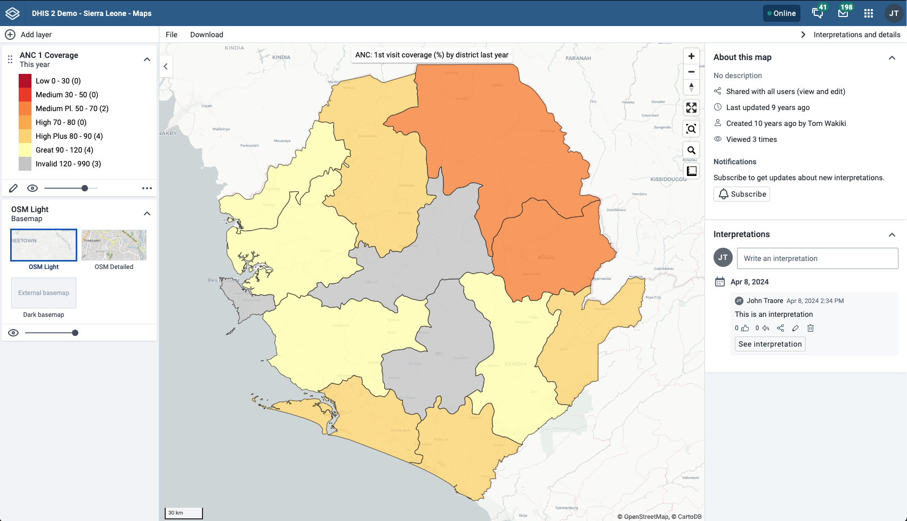

### View interpretations based on relative periods

To view interpretations for relative periods, such as a year ago:

1.  Open a saved map with interpretations.

2.  Click **Interpretations and details** in the top right of the workspace to open the
    interpretations panel.

3.  Click **See interpretation**. Your map shows the data and the date based on when the
    interpretation was created. To view other interpretations, click them.

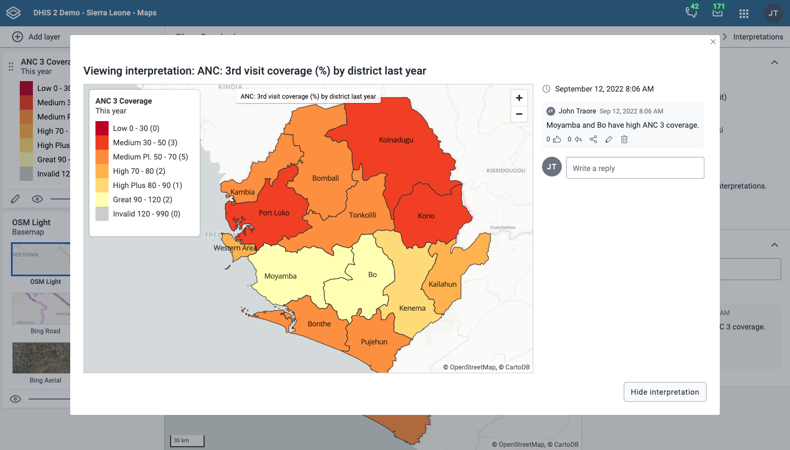

### Write interpretation for a map

To create an interpretation, you first need to create a map and save it. If you have shared your map
with other people, the interpretation you write is visible to those people.

1.  Open a saved map.

2.  Click **Interpretations and details** in the top right of the workspace to open the
    interpretations panel.

3.  A text field appears where you can write an interpretation.

4.  In the text field, type a comment, question or interpretation. You can also mention other users
    with `@username`. Start by typing `@` followed by the first letters of the username or real
    name, and a list of matching users will appear. Mentioned users will receive an internal DHIS2
    message with the interpretation or comment. You can see the interpretation in the **Dashboard**
    app.

5.  Click **Post interpretation** to save the interpretation.

### Change sharing settings for an interpretation

1.  Click an interpretation (see the section View interpretations based on relative periods).

2.  Click the share icon below the interpretation. The sharing settings dialog opens.

3.  Search for and add users and user groups that you want to share your map with, and set the
    access level. Click **Give access**.

4.  Change the access level for the users you want to modify:

    -   **No access**: The public will not have access to the map. This setting is only applicable
        to All users.

    -   **View only**: Users can view but not edit the map.

    -   **View and edit**: Users can view and edit the map.

    -   **Remove access**: Remove the access for groups or individuals.

5.  Click **Close** when sharing settings are updated.

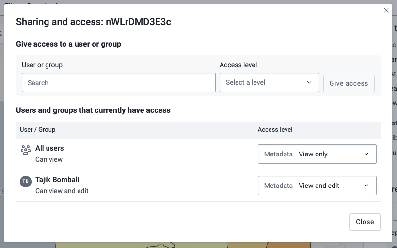
## Save a map as an image { #using_maps_image_export }

You can download your map as an image by clicking the **Download** button in the top menu.

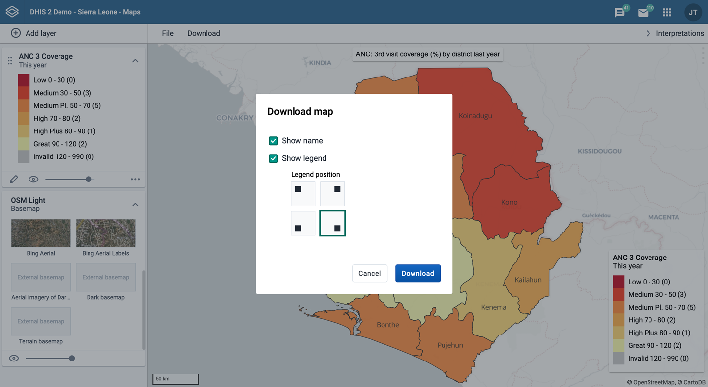

You will enter **Download mode** where you can adjust the map layout before you download the image.
The left column gives you the following options:

-   **Show map name**: Choose if you want to include the map name or not. This option is only
    available if the map is saved. To change the name, exit download mode and choose **File** \>
    **Rename**.
-   **Show map description**: Choose if you want to include the map description or not. This option
    is only available if a map description was added when the map was saved. To change the map
    description, exit download mode and choose **File** \> **Rename**.
-   **Show legend**: Choose if you want to include the map legend. If the map includes more than one
    layer, you can choose the visibility for each legend.
-   **Show overview map**: Choose if you want to include an overview map (often named inset map).
    This option will be disabled if there is not enough room for it in the right column.
-   **Show north arrow**: Choose to include a north arrow on the map. The default position is the
    lower right corner of the map, but you can change it to another corner.

Click **Download** to download your map.

Resize your browser window to change the map dimensions. You can also reposition both the main map
and the overview map.
## Search for a location { #using_maps_search }

The place search function allows you to search for almost any location or address. This is useful to
locate sites, facilities, villages or towns on the map.

1.  On the right side of the Maps window, click the magnifier icon.

2.  Type the location you are looking for.

    A list of matching locations appear as you type.

3.  From the list, choose a location. A pin indicates the location on the map.
## Measure distances and areas in a map { #using_maps_measure_distance }

1.  In the upper left part of the map, put the cursor on the **Measure distances and areas** (ruler)
    icon and click **Create new measurement**.

2.  Add points to the map.

3.  Click **Finish measurement**.

## Get the latitude and longitude at any location { #using_maps_latitude_longitude }

Right-click a point on the map and choose **Show longitude/latitude**. The values are shown in a
popup window.
## Maps app administrator { #maps_app_administrator }

A **Maps** app administrator can be defined by the system administrator assigning the
`F_EXTERNAL_MAP_LAYER_PUBLIC_ADD` authority. Users with the `ALL` authority are also Maps app
administrators.

The **Maps** app administrator is able to:

-   Choose the sources for Google Earth Engine layers available to other users using the **Manage
    available layer sources** button.

-   Add new external layer sources in the Maintenance app. The **Metadata Management** app does not
    manage external map layers.

## See also

-   Configuration:

    -   [Configure DHIS2 Maps](#gis_creating)
    -   [Google Earth Engine sign-up](#google_earth_engine_sign_up)
    -   [Geo-enabled microplanning](#geoenabled-microplanning), including details about facility
        catchment areas

-   Settings:

    -   [Infrastructural indicators / Infrastructural data elements / Infrastructural period type](#system_server_settings)
    -   [Use centroids for organisation unit polygons in event analytics / Organisation unit group set in facility map layers / Organisation unit level in facility map layers / Default basemap](#system_server_settings)
    -   [Bing Maps / Azure Maps API keys](#system_server_settings)

-   Metadata management (the Metadata Management app replaces the Maintenance app and works with
    DHIS2 2.41 and later):

    -   Manage legends: [Metadata Management app](#mm_manage_legend),
        [Maintenance app](#manage_legend)
    -   Aggregation operators: [Metadata Management app](#mm_create_data_element),
        [Maintenance app](#create_data_element)

-   Training:
    -   [Trainer's Guide to Maps](#trainers-guide-to-maps)
    -   [Learner's Guide to Maps](#learners-guide-to-maps)
