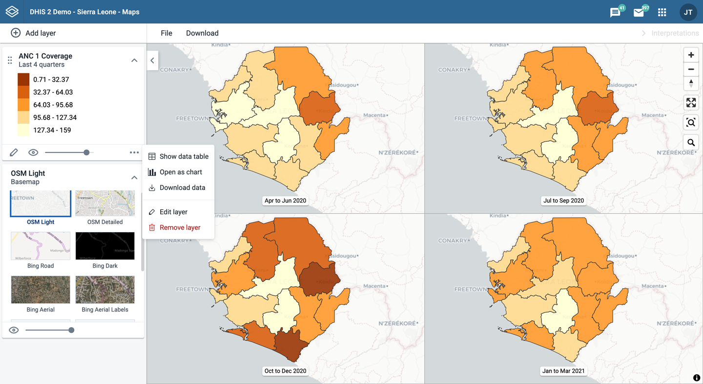
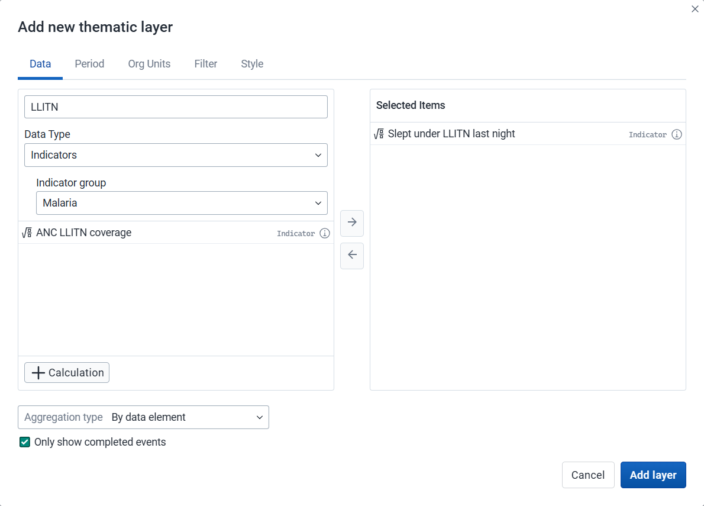
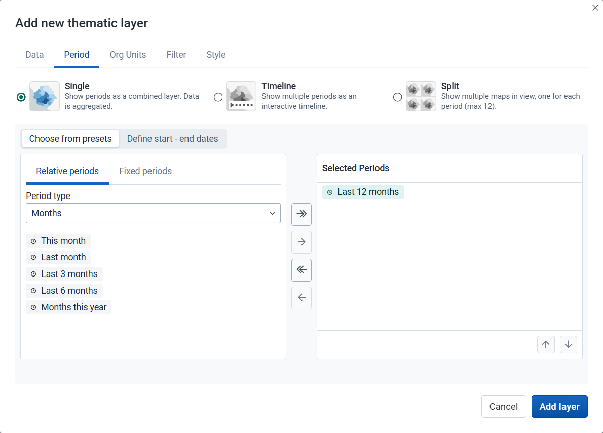
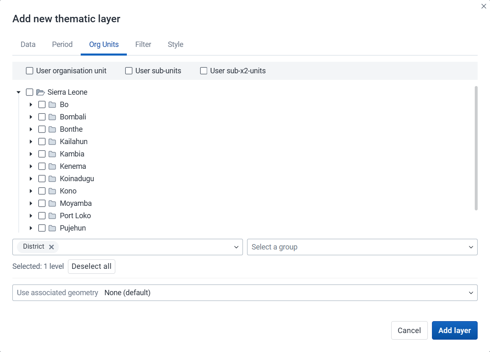
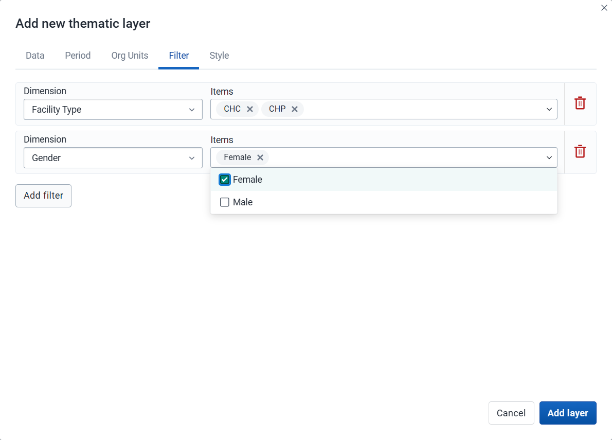
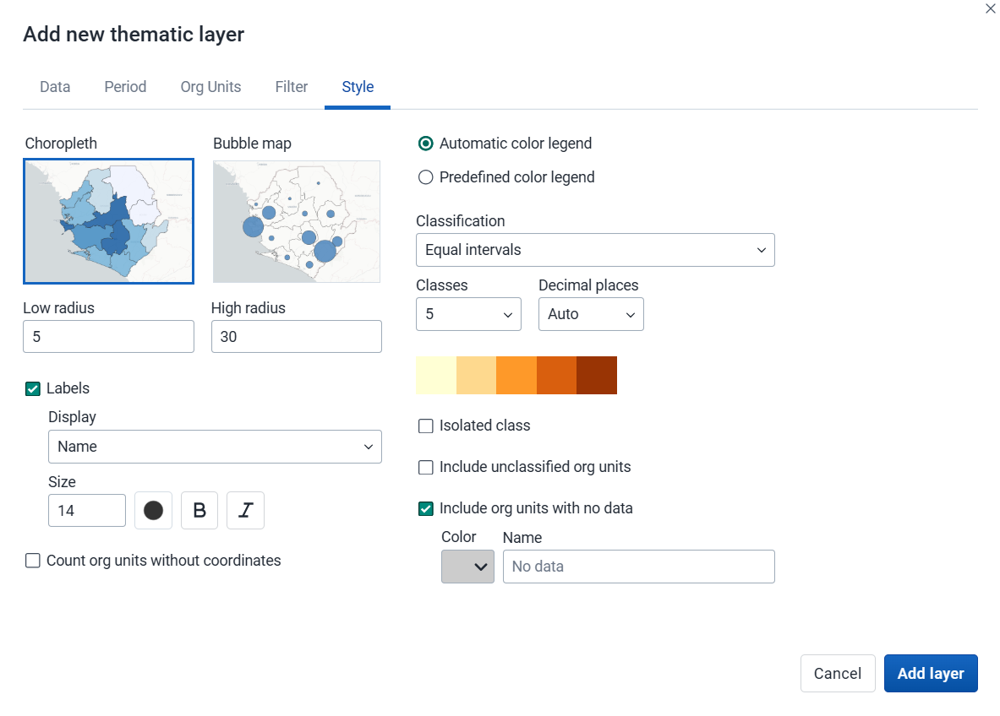
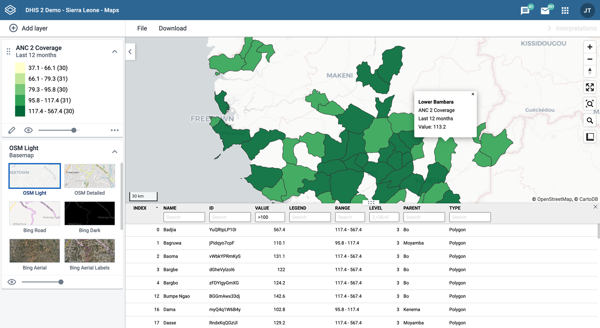

## Manage thematic layers { #using_maps_thematic_layer }

_Thematic maps_ represent spatial variation of geographic distributions. They show aggregated data
values for a selected data item (such as an indicator or data element), period and organisation unit
level. Organisation units with coordinates and matching data values will appear on the map.

> **Note**
>
> You must generate the DHIS2 analytics tables to have aggregated data values available.

Thematic layers are represented by layer cards in the layer panel. The middle of the card shows a
legend indicating the value ranges shown on the layer. The more actions (three dots) button includes
options to show or hide the data table, download the data, and open the data as a chart in the Data
Visualizer app using **Open in Data Visualizer app**.

### Create a thematic layer

To create a thematic layer, choose **Thematic** on the **Add layer** selection. This opens the
Thematic layer configuration dialog.

#### 1. Data

-   Choose a data item.

-   Choose a value from the **Aggregation type** field for the data values to be shown on the map.
    By default, "By data element" is selected. Alternative values are: Count, Average, Sum, Standard
    deviation, Variance, Min, Max. See also
    [Aggregation operators](https://docs.dhis2.org/en/use/user-guides/dhis-core-version-master/configuring-the-system/metadata-metadata-management-app.html#mm_create_data_element).

-   **Only show completed events**: Includes only completed events in the aggregation process. This
    is useful when you want to exclude partial events in indicator calculations. Available for
    indicators, program indicators and event data items.

#### 2. Period

Choose the time span over which the thematic data is mapped.

-   Choose how to show the selected periods on the map:

    -   **Single** (default): Shows all selected periods as a single combined layer with aggregated
        data. Required when only one period is selected or when using start–end dates.

    -   **Timeline**: Shows multiple periods as an interactive timeline ordered chronologically.
        Multiple timeline layers can be added to a map (they will all share the same periods).

    -   **Split**: Shows multiple periods side by side for comparison. Supports up to 12 periods
        (including multi-period presets) and can only be combined with other split layers (they will
        all share the same periods).

-   After you choose a display mode, choose how to define the periods:

    -   **Choose from presets**: Available for all display modes. You can combine one or more
        relative and fixed periods.

        -   _Relative period_: Choose **Relative periods**, then the **Period type** (for example
            **Years** or **Months**) and choose one or more relative periods, such as **This year**
            and **Last year** or **Last 12 months**. A **default relative period for analysis** can
            be set in the **System Settings** app.

        -   _Fixed period_: Choose **Fixed periods**, then choose the **Period type** (for example
            **Yearly** or **Monthly**) and choose one or more fixed periods, such as **2024** or
            **January 2025** and **February 2025**.

    -   **Define start–end dates**: Available only when the Single display mode is selected. Specify
        exact start and end dates. Both dates are inclusive and will be reflected in the outputs.

#### 3. Org units

-   Choose the organisation units you want to include in the layer. You can freely combine specific
    org units, organisation unit levels, organisation unit groups, and relative user organisation
    units (**User organisation unit**, **User sub-units**, **User sub-x2-units**). When user
    organisation units are selected, the map data will appear according to the assigned organisation
    units for each user in the organisation unit hierarchy.

    > **Tip**: Levels and groups act as filters within the organisation units you choose - combining
    > them will show only organisation units at those levels or in those groups that are descendants
    > of your selected organisation units.

-   **Use associated geometry**: This field is shown only if there are additional geometries
    available for your organisation units. This is typically used to show facility catchment areas.

#### 4. Filter

-   Click **Add filter** and choose an available data item to add a new filter to the data set.

    -   Choose a data dimension from the menu. You can reduce the number of dimensions shown by
        using the search field. Click the name to choose a dimension.

    -   When a dimension is selected you get a second menu with dimension items. Check the items you
        want to include in the filter.

    You can add multiple filters. Click the trash button on the right of the filter to remove it.

#### 5. Style { #using_maps_thematic_layer_style }

-   Choose either **Choropleth** or **Bubble map**.

    -   A choropleth map assigns a color to each organisation unit shape according to the data
        value. This is the recommended technique if the data is normalized (per capita).

    -   A bubble map shows data values as proportional circles. Use this technique if the data is
        not normalized (absolute numbers). The circles are placed in the center of each organisation
        unit. Set the **Low radius** and **High radius** for the proportional circles. The circles
        will be scaled between low and high radius according to the data value. The radius must be
        between 0 and 50 pixels.

-   **Labels**: Show organisation unit names and/or values on the layer. Choose **Name**, **Name and
    value**, or **Value**. Font size, weight, style and color can also be modified.

-   **Count org units without coordinates**: Organisation units without map coordinates are counted
    and shown in a **Data quality** section of the legend. They also appear in the data table. These
    organisation units might or might not have data.

-   Choose the legend type:

    -   **Automatic color legend**: A legend is automatically created based on the classification
        method, number of classes and color scale you choose. Set **Classification** to one of:

        -   **Equal intervals**: Divides the value range into equally-sized intervals, each spanning
            (highest value − lowest value) ÷ number of classes.
        -   **Equal counts**: Organisation units are distributed as evenly as possible across
            classes (also known as quantile classification). Some datasets cannot be evenly
            partitioned, particularly when values are heavily repeated or the number of distinct
            values is small.
        -   **Natural breaks (intervals)** and **Natural breaks (clusters)**: Class boundaries are
            placed at the largest gaps in the data distribution, based on the
            [ckmeans](https://simple-statistics.github.io/docs/#ckmeans) algorithm. Both methods
            group values similarly; **Natural breaks (intervals)** produces contiguous class ranges,
            while **Natural breaks (clusters)** can leave gaps between classes where no values fall.
        -   **Pretty breaks**: Break points are rounded to clean, human-readable numbers. Based on
            R's [pretty](https://www.rdocumentation.org/packages/base/versions/3.6.2/topics/pretty)
            algorithm.
        -   **Logarithmic scale**: Uses a logarithmic scale. Values must be positive; zero or
            negative values are left unclassified.
        -   **Standard deviation**: Classes are defined as multiples of standard deviations from the
            mean. The number of standard deviations per class depends on the number of classes
            chosen; values further from the mean are left unclassified.

        **Decimal places**: Number of decimal places shown in legend labels. **Auto** lets the app
        decide based on the data range, or choose a fixed value from **0** to **6** (also available
        for single color legends).

        **Isolated class**: Define a value range (min–max) with a fixed color and optional label.
        Organisation units in that range are shown separately and excluded from automatic
        classification.

    -   **Predefined color legend**: Choose from the predefined legends.

    -   **Single color legend**: Choose the color of the bubbles or circles. Only available for
        bubble maps.

-   **Include unclassified org units**: Organisation units whose values fall outside all
    classification ranges are shown with a configurable color and label (default: "Unclassified").

-   **Include org units with no data**: Organisation units with no data value are shown with a
    configurable color and label (default: "No data").

> **Note**: All legend items and their counts - including **No data** and **Unclassified** - only
> include organisation units with coordinates.

> **Note**
>
> Most classes use half-open intervals (`startValue ≤ value < endValue`): a value sitting exactly on
> a boundary belongs to the upper class, not the one whose label ends there. The exceptions - where
> the upper bound is inclusive - are the last class, isolated classes, single-value classes, and
> clusters (natural breaks).
>
> If the exact class a boundary value belongs to matters for your analysis, use **Labels** to
> overlay values directly on each feature. If it still matters after that, consider whether a
> different legend, maybe with more classes or higher decimal precision, is the right tool for the
> decision you are trying to make.

Click **Add layer**.

### Modify a thematic layer

1.  In the layer panel, click the edit (pencil) icon on the thematic layer card.

2.  Modify the settings on any of the tabs as desired.

3.  Click **Update layer**.

### Filter values in a thematic layer

Thematic layers have a **Show data table** option in the more actions (three dots) menu of the layer
card. When the table is open, the option changes to **Hide data table**.

The data table shows the data associated with the thematic layer. Click the arrow buttons in a
column header to sort by that column. Type in the filter fields below each column header to filter
the rows shown.

The name filter field is an effective way to search for individual organisation units.

For numeric columns, you can filter using comparison operators: `>`, `<`, `>=`, and `<=`. Use `,`
for OR logic and `&` for AND logic. For example: `2,>3&<8` matches the value 2 or any value greater
than 3 and less than 8.

> **Note**
>
> Data table filters are temporary and are not saved with the map.

### Open organisation unit profile

You can open the [organisation unit profile](#using_maps_org_unit_profile) in three ways:

1. Click an organisation unit on the map, then click the **View profile** button in the popup.

2. Right-click one of the organisation units on the map, and choose **View profile** from the menu.

3. Click an organisation unit row in the **data table**.

### Navigate between organisation unit hierarchies

When there are visible organisation units on the map, you can navigate up and down in the hierarchy
without changing the organisation unit selection.

1.  Right-click one of the organisation units.

2.  Choose **Drill up one level** or **Drill down one level**.

    The drill down option is disabled if you are on the lowest level or if there are no coordinates
    available on the level below. Likewise, the drill up option is disabled from the highest level.

### Remove a thematic layer

To remove a thematic layer from the map, in the layer card to the left, click the _more actions_
(three dots) icon and then click **Remove layer**.
