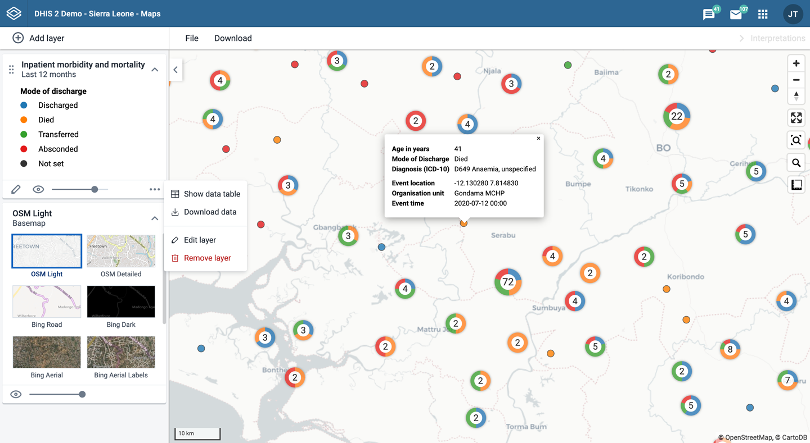
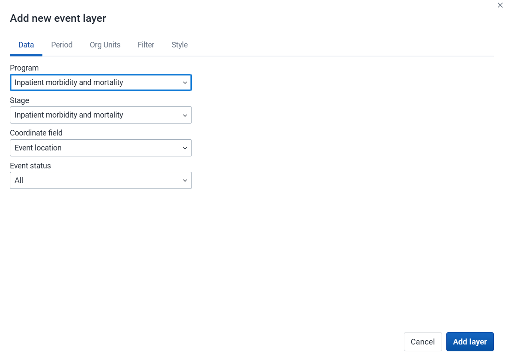
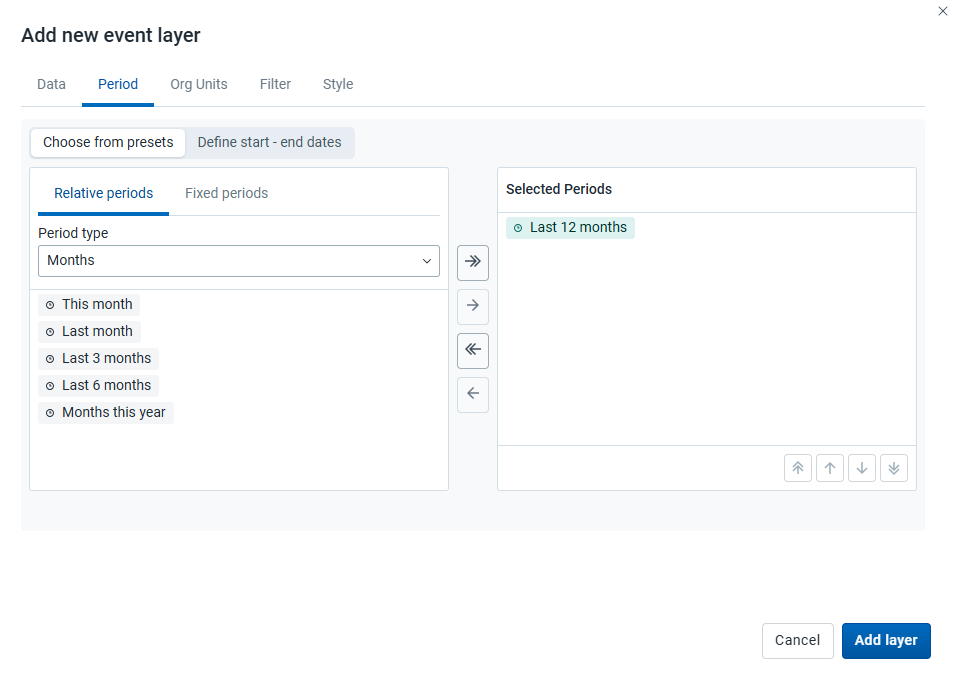
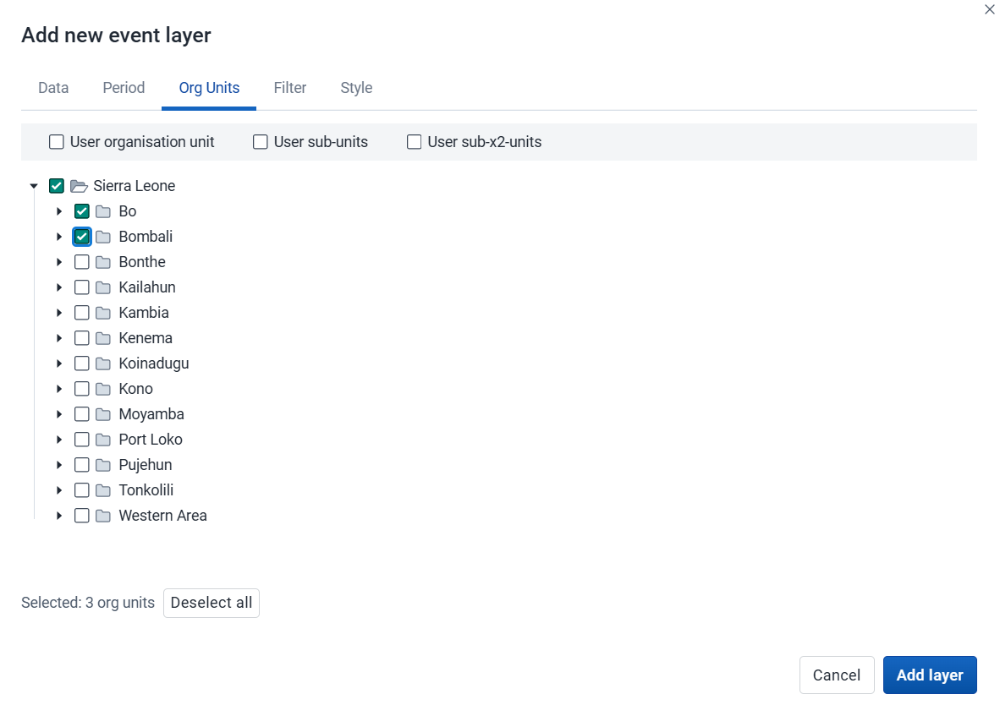
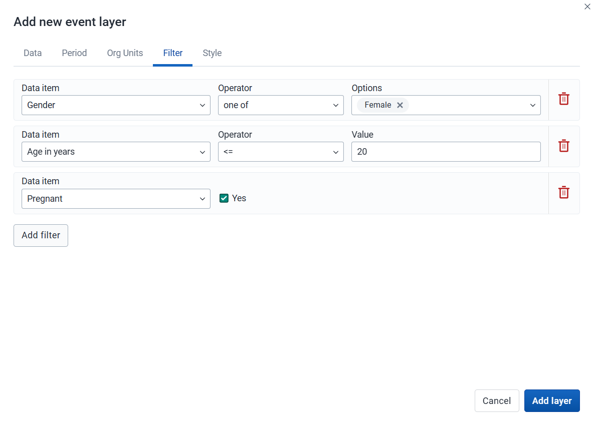
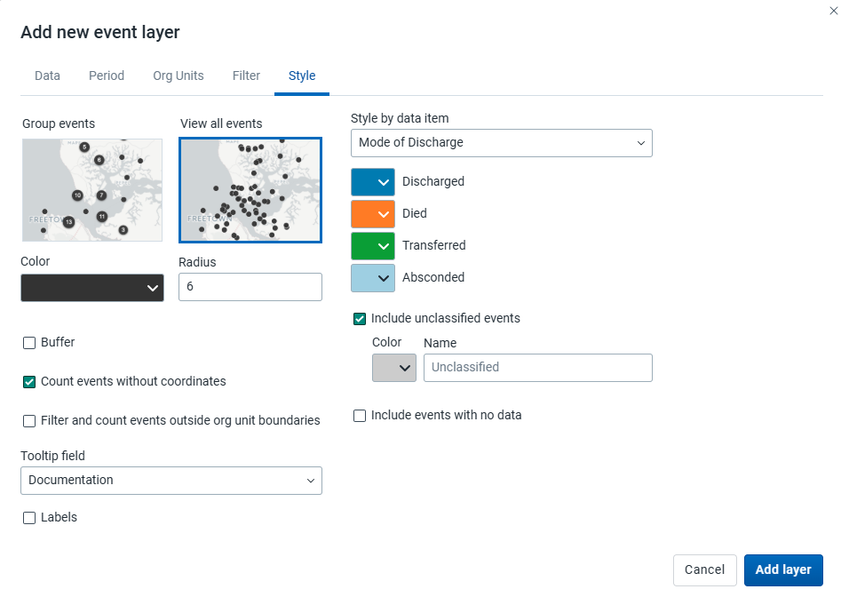
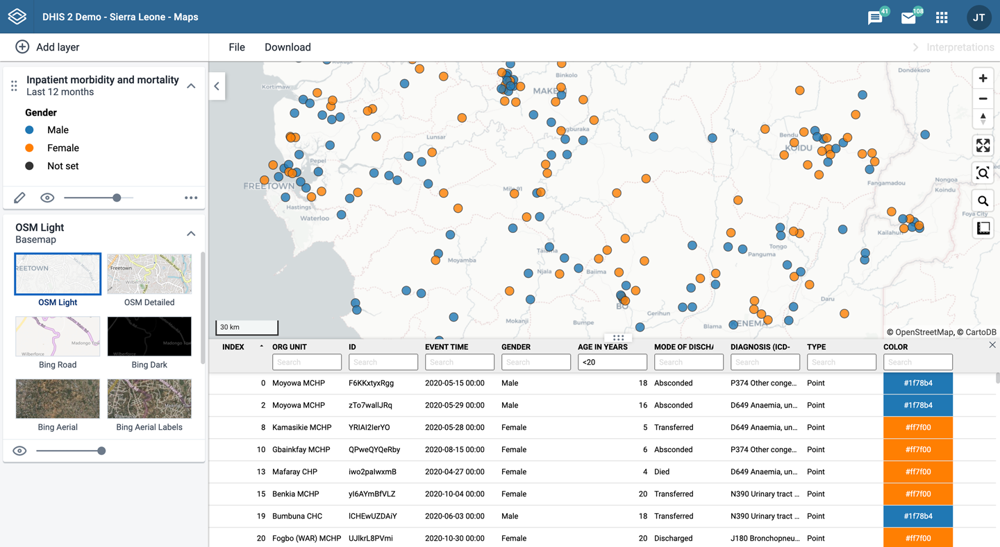
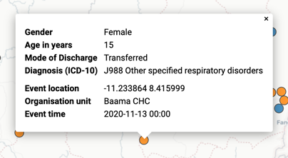
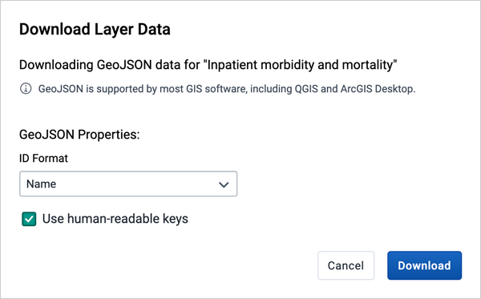

## Manage event layers { #using_maps_event_layer }

The event layer shows the geographical location of events recorded in DHIS2 programs. While in
thematic layers you can visualize event data aggregated to organisation unit level, with event
layers you can show the individual events or cases when they have their own point or polygon
coordinates. Alternative coordinate fields also let you plot events using locations other than the
event itself, such as the organisation unit or enrollment location.

To show aggregated event statistics at the organisation unit level, use a thematic layer with event
data items instead.

Event layers are represented by layer cards in the layer panel. The middle of the card shows a
legend indicating the styling of the layer. The more actions (three dots) button includes options to
show or hide the data table and to download the data in GeoJSON format.

### Create an event layer { #maps_create_event_layer }

To create an event layer, choose **Events** on the **Add layer** selection. This opens the Events
layer configuration dialog.

#### 1. Data

-   Choose a program and then choose a program stage. The **Stage** field is shown only after you
    choose a program.

    If there is only one stage available for the selected program, the stage is automatically
    selected.

-   Choose a value from the **Coordinate field** to determine which positions are shown on the map.
    By default, **Event location** is selected. You can also choose **Organisation unit location**.
    Depending on the selected program, additional options can include **Tracked entity location**,
    **Enrollment location**, and coordinate or organisation unit type data elements or attributes,
    such as "Household location" or "Referral facility". The number of events shown on the map can
    vary depending on the selected option and the availability of coordinates. When organisation
    unit location is used, polygons are represented by their centroids.

-   By default, all events with coordinates are shown on the map. Use the **Event status** field to
    only show events having one status: Active or Completed.

#### 2. Period

Choose the time span for when the events took place.

-   **Choose from presets**: You can combine one or more relative and fixed periods.

    -   _Relative period_: Choose **Relative periods**, then the **Period type** (for example
        **Years** or **Months**) and choose one or more relative periods, such as **This year** and
        **Last year** or **Last 12 months**. A **default relative period for analysis** can be set
        in the **System Settings** app.

    -   _Fixed period_: Choose **Fixed periods**, then choose the **Period type** (for example
        **Yearly** or **Monthly**) and choose one or more fixed periods, such as **2024** or
        **January 2025** and **February 2025**.

-   **Define start–end dates**: Specify exact start and end dates. Both dates are inclusive and will
    be reflected in the outputs.

#### 3. Org units

-   Choose the organisation units you want to include in the layer. You can combine specific
    organisation units and relative user organisation units (**User organisation unit**, **User
    sub-units**, **User sub-x2-units**). When user organisation units are selected, the map data
    will appear according to the assigned organisation units for each user in the organisation unit
    hierarchy. Data from all organisation units within and below the selected organisation units is
    included (**Selected and all below**).

#### 4. Filter

-   Click **Add filter** and choose an available data item to add a new filter to the data set.

    -   For data item of type _option set_, you can choose any of the options from the menu, or type
        to filter.

    -   For data item of type _number_, you can choose operators like equal, not equal, greater than
        or less than.

    -   For data item of type _boolean_ (yes/no), you can check the box if the condition should be
        true.

    -   For data item of type _text_, choose **Contains** (matches any value containing the search
        text) or **Is exact** (matches only identical values).

    You can add multiple filters. Click the trash button on the right of the filter to remove it.

#### 5. Style

-   Choose **Group events** to group nearby events (cluster), or **View all events** to show events
    individually.

    -   Choose a **color** and **radius** for the event or cluster points.

    -   Choose **Buffer** to show a visual buffer around each event. The radius of the buffer can be
        modified here. Only available when **View all events** is selected.

-   **Count events without coordinates**: Events without coordinates are counted and shown in a
    **Data quality** section of the legend. They also appear in the data table. These events might
    or might not have data.

-   **Filter and count events outside org unit boundaries**: Events falling outside the boundaries
    of the selected organisation units are excluded from the map, and counted in the **Data
    quality** section of the legend, which also flags when some or all of the selected organisation
    units lack boundary data. These events remain in the data table, but can be identified by their
    empty **Organisation unit boundary** column value. Events inside a boundary are tagged with the
    name of their containing organisation unit in that same column.

-   **Label**: Choose a data element or attribute to show on the layer. Font size, weight, style and
    color can also be modified.

-   Choose **Style by data item** (data element or attribute) to colorize the events according to a
    data value. If events are grouped, clusters are shown as small donut charts showing the
    distribution of the data values. The available options vary for different data types:

    -   **Option sets**: Choose a color for each option in an option set. You can set default colors
        for an option in the Metadata Management app.

    -   **Numbers**: You can style a numeric data item in
        [the same way as thematic layers](#using_maps_thematic_layer_style) using automatic or
        predefined legends.

    -   **Booleans**: Choose a color for true/yes and another for false/no.

    **Include unclassified events**: Events whose values fall outside all classification ranges are
    shown with a configurable color and label (default: "Unclassified").

    **Include events with no data**: Events with no data value are shown with a configurable color
    and label (default: "No data").

> **Note**: All legend items and their counts - including **No data** and **Unclassified** - only
> include events with coordinates.

Click **Add layer**.

### Modify an event layer

1.  In the layer panel, click the edit (pencil) icon on the event layer card.

2.  Modify the settings on the **Data**, **Period**, **Filter**, **Org units** and **Style** tabs as
    desired.

3.  Click **Update layer**.

### Filter events

Event layers have a **Show data table** option in the more actions (three dots) menu of the layer
card. When the table is open, the option changes to **Hide data table**.

The data table shows the data associated with the event layer. Click the arrow buttons in a column
header to sort by that column. Type in the filter fields below each column header to filter the rows
shown.

Additional columns appear for data elements that have **Display in reports** selected, and for any
data item used to style the events. You can filter both the data value and the color in those
columns. Numeric columns support comparison operators: `>`, `<`, `>=`, and `<=`, with `,` for OR and
`&` for AND logic. For example: `2,>3&<8`.

> **Note**
>
> Data table filters are temporary and are not saved with the map.

### Modify information in event data table and popups

If you have access to the selected program in the Metadata Management app, you can modify the
information shown in the event popup window.

1.  Open the **Metadata Management** app.

2.  Choose **Programs**.

3.  Click the program you want to modify and choose **Data** or the stage first then **Data** in the
    case of a Tracker program.

4.  For every data element you want to show in the popup window, choose the corresponding **Display
    in reports**.

5.  Click **Save**.

### Download raw event layer data

The raw data for event layers can be downloaded in GeoJSON format for more advanced geo-analytics
and processing in desktop GIS software such as [QGIS](https://www.qgis.org/). The downloaded data
includes all individual events as GeoJSON features, including attributes for each data element
selected for **Display in reports**.

-   In the layer card to the left, click the _more actions_ (three dots) icon and then click
    **Download data**.

-   Choose the **ID Format** to use as the key for data element values in the downloaded GeoJSON
    file:

    -   **ID**: Use the unique ID of the data element.
    -   **Name**: Use the human-friendly name of the data element (translated).
    -   **Code**: Use the code of the data element.

-   Choose whether or not to **Use human-readable keys** for other event attributes, such as Program
    Stage, Latitude, Longitude, Event Data, and Org Unit ID, Name, and Code. When this option is
    **not** selected, these values will be computer-friendly IDs instead of human-readable
    (translated) names.

-   Click the **Download** button to generate and download a GeoJSON file. The data will be
    requested from the DHIS2 server and processed by the maps application. This operation can take
    several minutes to complete.

-   After you download the GeoJSON file, you can import it into most standard GIS software.

> **Note**
>
> The downloaded data does not include style information as it is not natively supported by the
> GeoJSON format. Styles can optionally be recreated in external GIS applications using the
> attributes of each feature.

### Remove an event layer

To remove an event layer from the map, in the layer card to the left, click the _more actions_
(three dots) icon and then click **Remove layer**.
