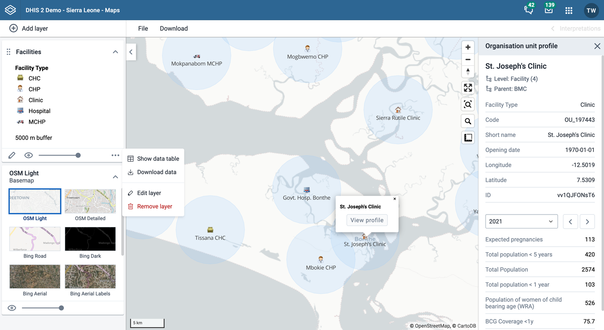
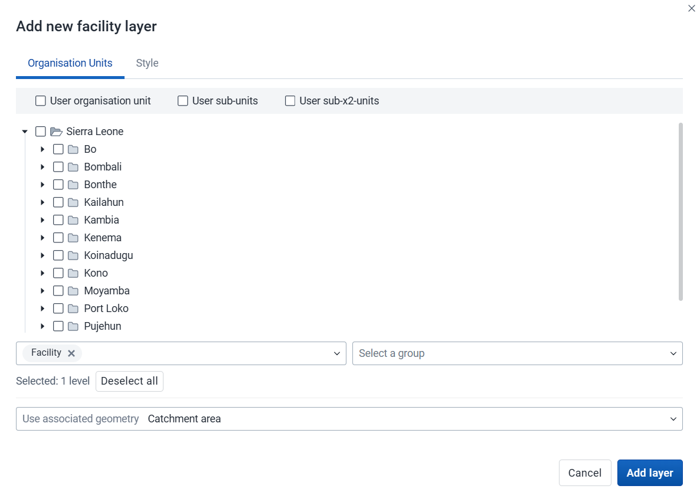
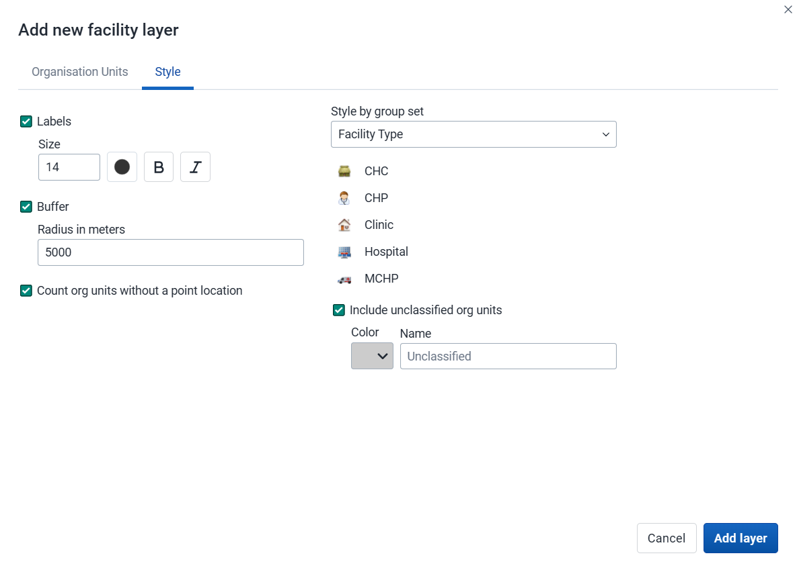
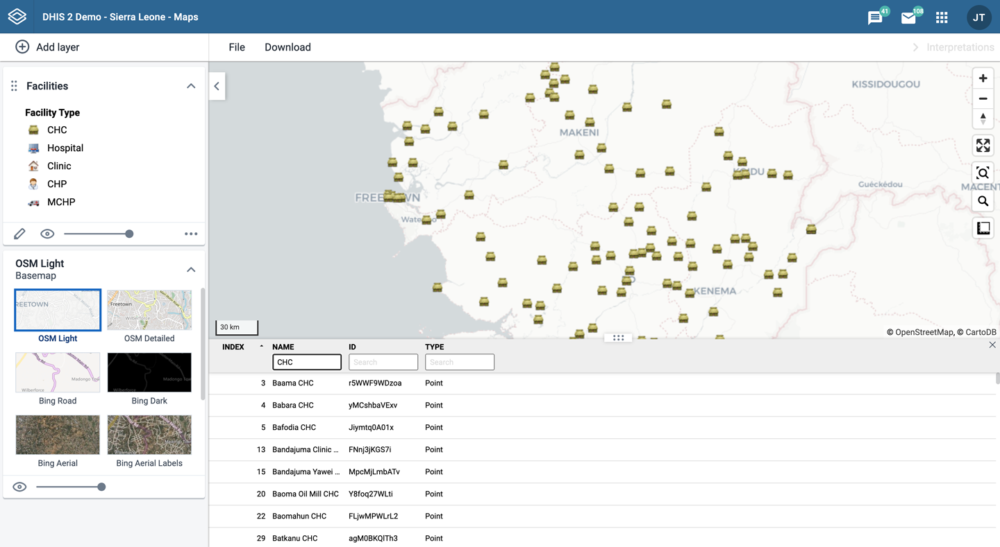

## Manage facility layers { #using_maps_facility_layer }

The facility layer shows icons representing types of facilities. Only point-type organisation units
are shown - polygon organisation units such as districts or regions are not shown.

Facility layers are represented by layer cards in the layer panel. The middle of the card shows a
legend indicating the group set representation. The more actions (three dots) button includes
options to show or hide the data table and to download the data in GeoJSON format.

### Create a facility layer

To create a facility layer, choose **Facilities** on the **Add layer** selection. This opens the
Facility layer configuration dialog.

#### 1. Org units

-   Choose the organisation units you want to include in the layer. You can freely combine specific
    org units, organisation unit levels, organisation unit groups, and relative user organisation
    units (**User organisation unit**, **User sub-units**, **User sub-x2-units**). When user
    organisation units are selected, the map data will appear according to the assigned organisation
    units for each user in the organisation unit hierarchy. Only organisation units with a point
    location are shown.

    > **Tip**: Levels and groups act as filters within the organisation units you choose - combining
    > them will show only organisation units at those levels or in those groups that are descendants
    > of your selected organisation units.

-   The system administrator can set the default organisation unit level containing facilities in
    the **System Settings** app.

-   **Use associated geometry**: This field is shown only if there are additional geometries
    available for your organisation units. This is typically used to show facility catchment areas.

#### 2. Style

-   **Labels**: Allows labels to be shown on the layer. Font size, weight and color can be modified
    here.

-   **Buffer**: Shows a visual buffer around each facility. The radius of the buffer can be modified
    here. Not available if associated geometry is used.

-   **Count org units without a point location**: Organisation units without point coordinates are
    counted and shown in a **Data quality** section of the legend. They also appear in the data
    table.

-   Facilities with a point location can be styled with an organisation unit group set using
    different icons. Choose a group set from the list of organisation unit group sets defined for
    your DHIS2 instance. The system administrator can set the default organisation unit group set in
    the **System Settings** app.

    **Include unclassified org units**: Organisation units not belonging to any group in the
    selected group set are shown with a configurable color and label (default: "Unclassified").

-   If no group set is selected, the facilities will be shown as filled circles. The color and
    radius can be changed.

Click **Add layer**.

### Modify a facility layer

1.  In the layer panel, click the edit (pencil) icon on the facility layer card.

2.  Modify the settings on the **Org units** and **Style** tabs as desired.

3.  Click **Update layer**.

### Filter values in a facility layer

Facility layers have a **Show data table** option in the more actions (three dots) menu of the layer
card. When the table is open, the option changes to **Hide data table**.

The data table shows the data associated with the facility layer. Click the arrow buttons in a
column header to sort by that column. Type in the filter fields below each column header to filter
the rows shown. The name filter field is an effective way to search for individual facilities.

> **Note**
>
> Data table filters are temporary and are not saved with the map.

### Open organisation unit profile

You can open the [organisation unit profile](#using_maps_org_unit_profile) in three ways:

1. Click an organisation unit on the map, then click the **View profile** button in the popup.

2. Right-click one of the organisation units on the map, and choose **View profile** from the menu.

3. Click an organisation unit row in the **data table**.

### Remove a facility layer

To remove a facility layer from the map, in the layer card to the left, click the _more actions_
(three dots) icon and then click **Remove layer**.
