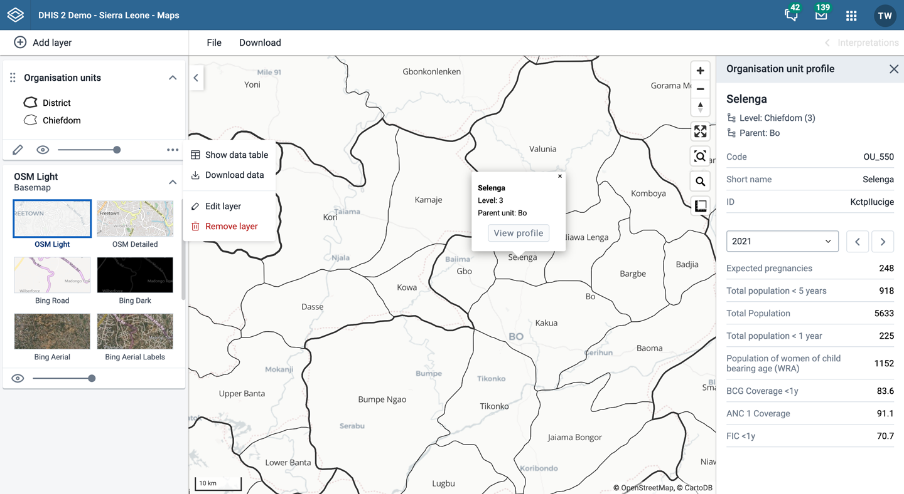
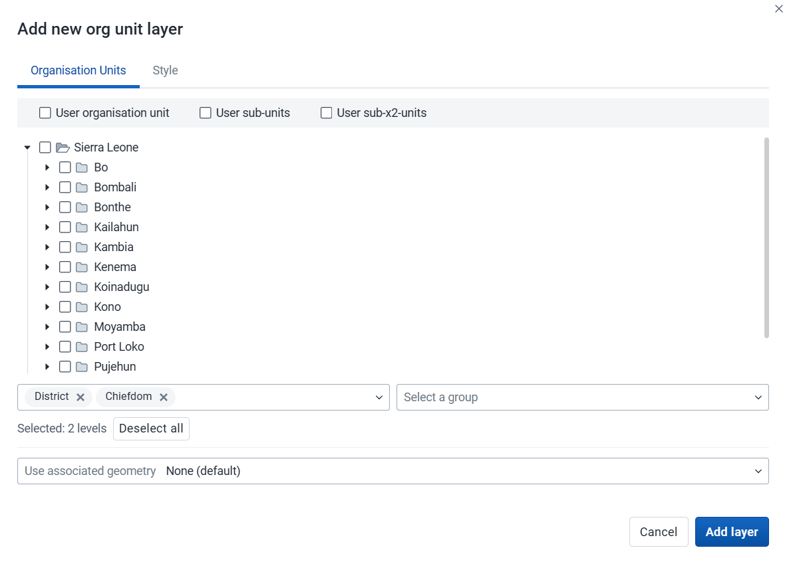
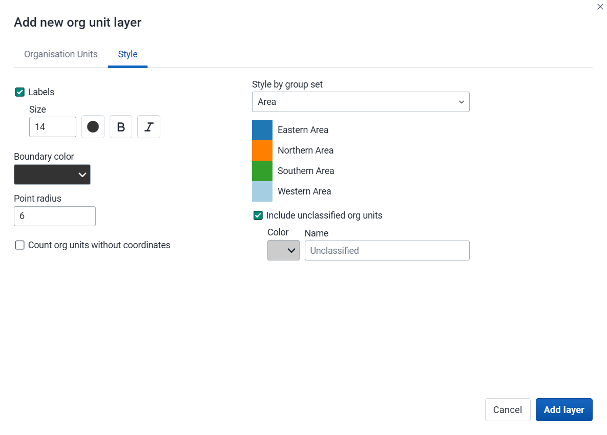
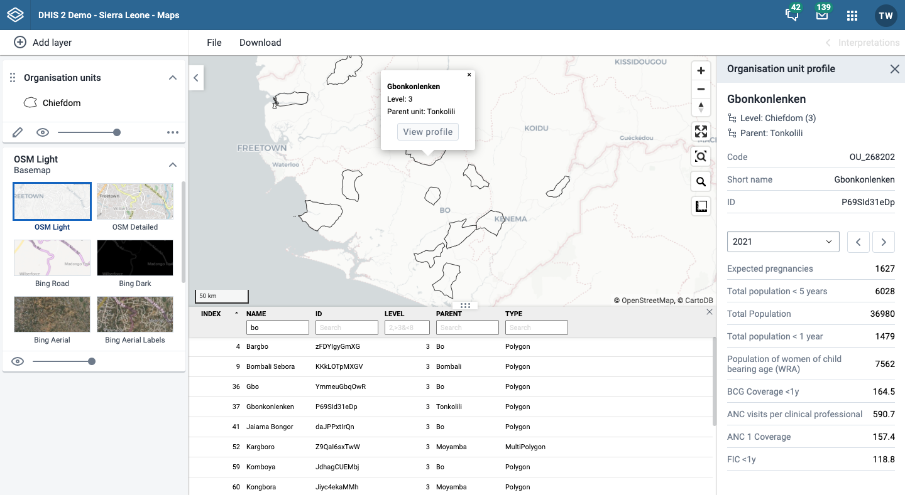

## Manage organisation unit layers { #using_maps_org_unit_layer }

The organisation unit layer shows the borders and locations of your organisation units. This layer
is particularly useful if you are offline and do not have access to background maps.

Organisation unit layers are represented by layer cards in the layer panel. The more actions (three
dots) button includes options to show or hide the data table and to download the data in GeoJSON
format.

### Create an organisation unit layer

To create an organisation unit layer, choose **Org units** on the **Add layer** selection. This
opens the Org unit layer configuration dialog.

#### 1. Org units

-   Choose the organisation units you want to include in the layer. You can freely combine specific
    org units, organisation unit levels, organisation unit groups, and relative user organisation
    units (**User organisation unit**, **User sub-units**, **User sub-x2-units**). When user
    organisation units are selected, the map data will appear according to the assigned organisation
    units for each user in the organisation unit hierarchy.

    > **Tip**: Levels and groups act as filters within the organisation units you choose - combining
    > them will show only organisation units at those levels or in those groups that are descendants
    > of your selected organisation units.

-   **Use associated geometry**: This field is shown only if there are additional geometries
    available for your organisation units. This is typically used to show facility catchment areas.

#### 2. Style

-   **Labels**: Allows labels to be shown on the layer. Font style can be modified here.

-   **Boundary color**: Allows the boundary or outline color of the organisation units to be
    changed.

-   **Point radius**: Sets the base radius when point type elements, such as facilities, are
    presented on the organisation unit layer.

-   **Count org units without coordinates**: Organisation units without coordinates are counted and
    shown in a **Data quality** section of the legend. They also appear in the data table.

-   Organisation units with coordinates can be styled with an organisation unit group set using
    different colors. Choose a group set from the list of organisation unit group sets defined for
    your DHIS2 instance.

    **Include unclassified org units**: Organisation units not belonging to any group in the
    selected group set are shown with a configurable color and label (default: "Unclassified").

Click **Add layer**.

### Modify an organisation unit layer

1.  In the layer panel, click the edit (pencil) icon on the organisation unit layer card.

2.  Modify the settings on the **Org units** and **Style** tabs as desired.

3.  Click **Update layer**.

### Filter values in an organisation unit layer

Organisation unit layers have a **Show data table** option in the more actions (three dots) menu of
the layer card. When the table is open, the option changes to **Hide data table**.

The data table shows the data associated with the organisation unit layer. Click the arrow buttons
in a column header to sort by that column. Type in the filter fields below each column header to
filter the rows shown. The name filter field is an effective way to search for individual
organisation units.

The level column supports numeric filtering using comparison operators: `>`, `<`, `>=`, and `<=`,
with `,` for OR and `&` for AND logic. For example: `2,>3&<8`.

> **Note**
>
> Data table filters are temporary and are not saved with the map.

### Open organisation unit profile

You can open the [organisation unit profile](#using_maps_org_unit_profile) in three ways:

1. Click an organisation unit on the map, then click the **View profile** button in the popup.

2. Right-click one of the organisation units on the map, and choose **View profile** from the menu.

3. Click an organisation unit row in the **data table**.

### Navigate between organisation unit hierarchies

When there are visible organisation units on the map, you can navigate up and down in the hierarchy
without changing the organisation unit selection.

1.  Right-click one of the organisation units.

2.  Choose **Drill up one level** or **Drill down one level**.

    The drill down option is disabled if you are on the lowest level. Likewise, the drill up option
    is disabled from the highest level.

### Remove an organisation unit layer

To remove an organisation unit layer from the map, in the layer card to the left, click the _more
actions_ (three dots) icon and then click **Remove layer**.
