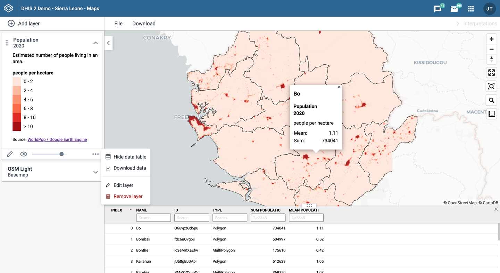
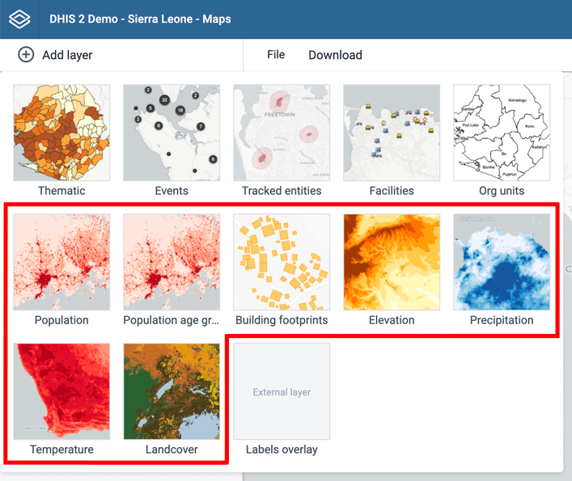
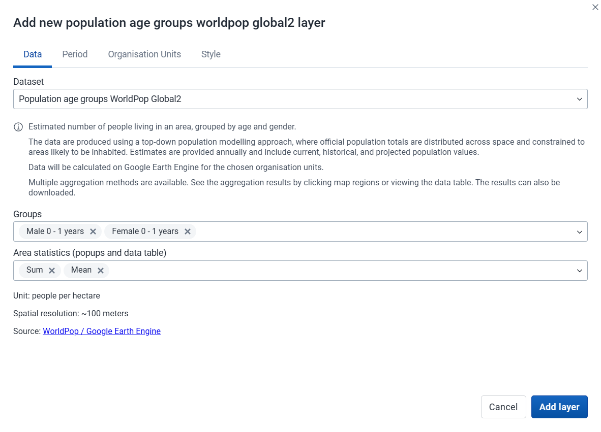
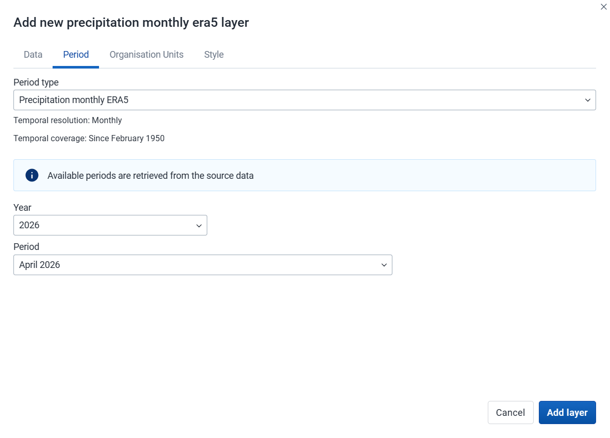
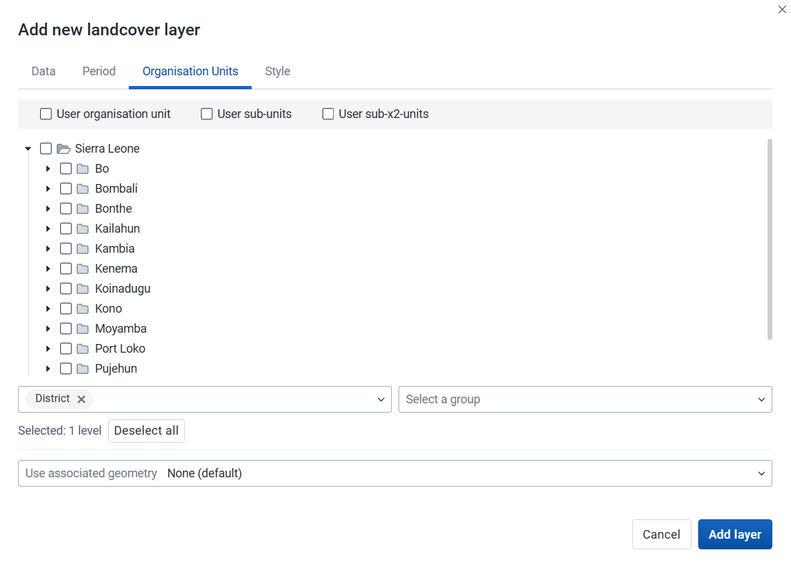
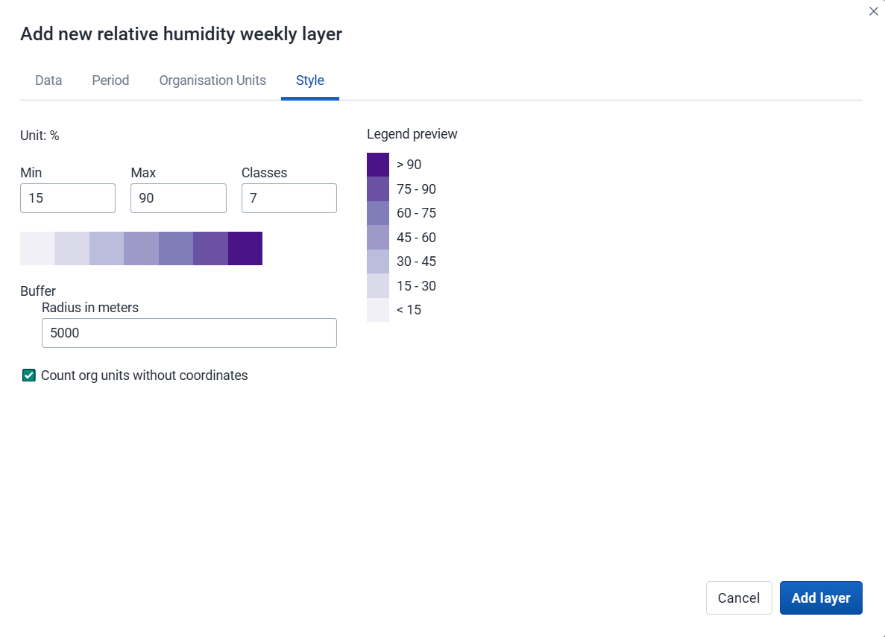
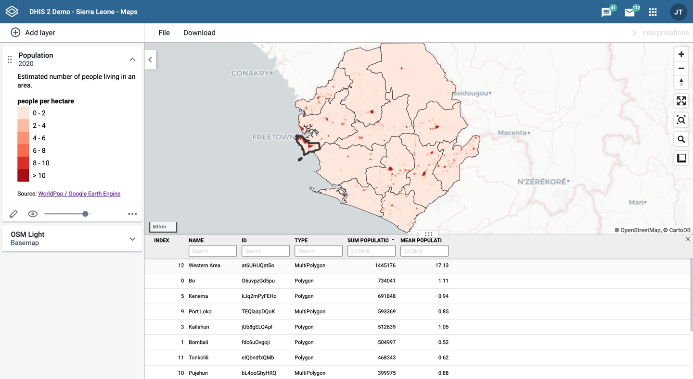

## Manage Earth Engine layers { #using_maps_gee }

Google Earth Engine layers are enabled if a Google Earth Engine service account key has been
configured for your system. Contact your system administrator if you need access to these layers.
System administrators can set up the key by following
[Google Earth Engine sign-up](#google_earth_engine_sign_up).

The layers from Google Earth Engine let you show and aggregate external data for your organisation
units. Aggregated values can be viewed either in popups or in the data table.

Earth Engine layers are represented by layer cards in the layer panel. The more actions (three dots)
button includes options to show or hide the data table and to download the data.

> **Note**
>
> The [**Maps app administrator**](#maps_app_administrator) can configure available layer sources.

The following layer sources are supported (sources marked with an asterisk "\*" are available by
default):

-   **Population** (group): Detailed population data from WorldPop. Estimates are provided annually
    and include current, historical, and projected population values. Available between 2015
    and 2030.

    -   **Population** \*: Total population count.
    -   **Population age groups** \*: Population broken down by age and gender.

-   **Building footprints** \*: The outlines of buildings derived from high-resolution satellite
    imagery. Only for sub-Saharan Africa, South and Southeast Asia, Latin America and the Caribbean.

-   **Elevation** \*: Elevation above sea level.

-   **Heat stress** (group): Universal Thermal Climate Index (UTCI), a measure of the thermal stress
    experienced by a person in a given environment. Available from 1950.

    -   **Heat stress daily**.
    -   **Heat stress weekly** (derived from daily dataset).
    -   **Heat stress monthly** (derived from daily dataset).

-   **Relative humidity** (group): Relative humidity is the amount of water vapour present in air.
    Available from 1950.

    -   **Relative humidity daily**.
    -   **Relative humidity weekly** (derived from daily dataset).
    -   **Relative humidity monthly**.

-   **Precipitation** (group): Accumulated water that falls to the surface. Combines model data with
    observations from across the world. Two sources are available:

    -   ERA5-Land. Available from 1950.
        -   **Precipitation daily**.
        -   **Precipitation weekly** (derived from daily dataset).
        -   **Precipitation monthly** \*.
    -   CHIRPS. Available from 1981.
        -   **Precipitation daily**.
        -   **Precipitation weekly** (derived from daily dataset).
        -   **Precipitation monthly** (derived from daily dataset).

-   **Temperature** (group): Temperature at 2m above the surface. Combines model data with
    observations from across the world. Available from 1950.

    -   **Temperature daily**.
    -   **Temperature weekly** (derived from daily dataset).
    -   **Temperature monthly** \*.

-   **Landcover** \*: 17 distinct landcover types collected from satellites by NASA. Available
    yearly since 2001.

-   **Vegetation**: Normalized difference vegetation index (NDVI) and Enhanced Vegetation Index
    (EVI), used to quantify vegetation greenness. Collected from satellites by NASA. Available at
    16-day intervals, from 2000.
    -   **Vegetation 16-day**
    -   **Vegetation weekly** (derived from 16-day dataset).
    -   **Vegetation monthly** (derived from 16-day dataset).

### Create an Earth Engine layer

To create an Earth Engine layer, choose the desired layer from the **Add layer** selection. This
opens the layer configuration dialog.

#### 1. Data

-   **Dataset** (if within a data group):

    -   For **Population** you can choose either the **Population** or the **Population age group**
        dataset.

-   **Data subset**:

    -   For **Population age groups** you can choose the age/gender **groups** you would like to
        include when aggregating the data.
    -   For **Temperature** or **Heat stress** you can choose the **temporal aggregation method**
        you want to use (Mean, Min, Max).
    -   For **Vegetation** you can choose the **index** you want to use (NDVI or EVI).

-   Choose the **spatial aggregation methods** to use when calculating values for the selected org
    units. This only affects results in popups and the data table (some options might not be
    available depending on the layer source).

    -   **Sum**: Calculates the total number within each organisation unit. Recommended to use for
        the population layers.

    -   **Min**: Returns the minimum value in the layer unit shown below the selection. For
        population layers it will be the minimum _people per hectare_. For the elevation layer it
        will return the lowest elevation (meters above sea level).

    -   **Max**: Returns the maximum value in the layer unit. For population layers it will be the
        maximum _people per hectare_. For the elevation layer it will return the highest elevation
        for each organisation unit.

    -   **Mean**: Returns the mean value in the layer unit. For population layers it will be the
        mean _people per hectare_. For the precipitation layer it will be the mean rainfall in
        millimeters across the organisation unit.

    -   **Median**: Returns the median value in the layer unit. For population layers it will be the
        median _people per hectare_. For the temperature layer it will be the median °C across the
        organisation unit.

    -   **Standard deviation**: Returns the standard deviation value in the layer unit.

    -   **Variance**: Returns the variance value in the layer unit.

    -   **Special cases**:
        -   For "building footprints": **Count**: Returns the number of buildings within each org
            unit. Note that building counts are only available for smaller organisation unit areas.
        -   For "landcover": **Percentage**, **Hectares**, **Acres**: Return the area covered by
            each landcover category within each organisation unit in different units.

#### 2. Period

-   Choose the period type (if multiple sources are enabled for **Heat stress**, **Precipitation**,
    **Temperature**, or **Vegetation**).

-   Choose the period for the data source. The available periods are set by the layer source. Some
    sources are only available at a single point in time.

#### 3. Org units

-   Choose the organisation units where you want to see aggregated data values. You can freely
    combine specific organisation units, organisation unit levels, organisation unit groups, and
    relative user organisation units (**User organisation unit**, **User sub-units**, **User
    sub-x2-units**). When user organisation units are selected, the map data will appear according
    to the assigned organisation units for each user in the org unit hierarchy.

    > **Tip**: Levels and groups act as filters within the organisation units you choose - combining
    > them will show only organisation units at those levels or in those groups that are descendants
    > of your selected organisation units.

-   **Use associated geometry**: This field is shown only if there are additional geometries
    available for your organisation units. This is typically used to calculate values for facility
    catchment areas.

#### 4. Style

-   Adjust the legend **Min**, **Max**, number of **Classes**, and color map, as desired.

-   **Buffer**: If you choose organisation units with a single point coordinate (facilities), you
    can set a radius buffer to calculate the data value within. A radius of 5000 meters will
    aggregate all values available within a 5 km distance from a facility. Buffer option is not
    available if associated geometry is used.

-   **Count org units without coordinates**: Organisation units without coordinates are counted and
    shown in a **Data quality** section of the legend. They also appear in the data table.

Click **Add layer**.

Click an organisation unit or facility on the map to see the aggregation result.

### Modify an Earth Engine layer

1.  In the layer panel, click the edit (pencil) icon on the Earth Engine layer card.

2.  Modify the settings on the **Data**, **Period**, **Org units**, and **Style** tabs as desired.

3.  Click **Update layer**.

### Filter values in an Earth Engine layer

Earth Engine layers have a **Show data table** option in the more actions (three dots) menu of the
layer card. When the table is open, the option changes to **Hide data table**.

The data table shows all the aggregated values for the selected organisation units. Click the arrow
buttons in a column header to sort by that column. Type in the filter fields below each column
header to filter the rows shown.

There is one column for each selected aggregation type. These numeric columns support comparison
operators: `>`, `<`, `>=`, and `<=`, with `,` for OR and `&` for AND logic. For example: `2,>3&<8`.

> **Note**
>
> Data table filters are temporary and are not saved with the map.

### Open organisation unit profile

You can open the [organisation unit profile](#using_maps_org_unit_profile) in three ways:

1. Click an organisation unit on the map, then click the **View profile** button in the popup.

2. Right-click one of the organisation units on the map, and choose **View profile** from the menu.

3. Click an organisation unit row in the **data table**.

### Remove an Earth Engine layer

To remove an Earth Engine layer from the map, in the layer card to the left, click the _more
actions_ (three dots) icon and then click **Remove layer**.
