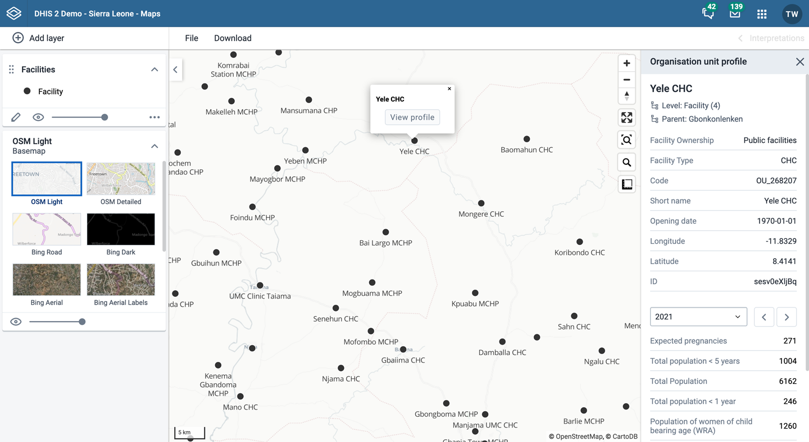

## Organisation unit profile { #using_maps_org_unit_profile }

The organisation unit profile shows detailed information about each organisation unit. You can open
the profile from organisation unit layers, facility layers, thematic layers, and Earth Engine
layers.

You can open the organisation unit profile in three ways:

1. Click an organisation unit on the map, then click the **View profile** button in the popup.

2. Right-click one of the organisation units on the map, and choose **View profile** from the menu.

3. Click an organisation unit row in the **data table**.

The profile will show on the right side of the map. The profile content is set by the system
administrator.
