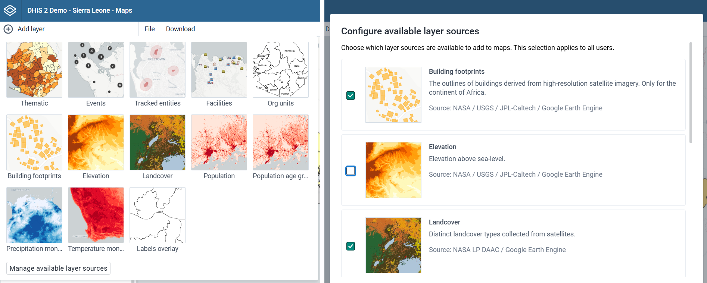
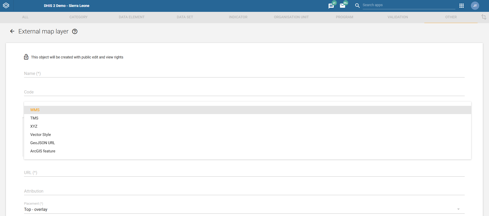

## Maps app administrator { #maps_app_administrator }

A **Maps** app administrator can be defined by the system administrator assigning the
`F_EXTERNAL_MAP_LAYER_PUBLIC_ADD` authority. Users with the `ALL` authority are also Maps app
administrators.

The **Maps** app administrator is able to:

-   Choose the sources for Google Earth Engine layers available to other users using the **Manage
    available layer sources** button.

-   Add new external layer sources in the Maintenance app. The **Metadata Management** app does not
    manage external map layers.

